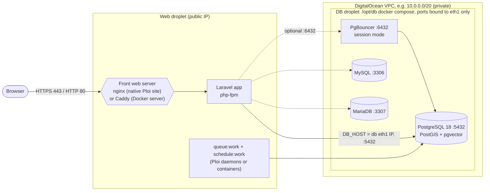
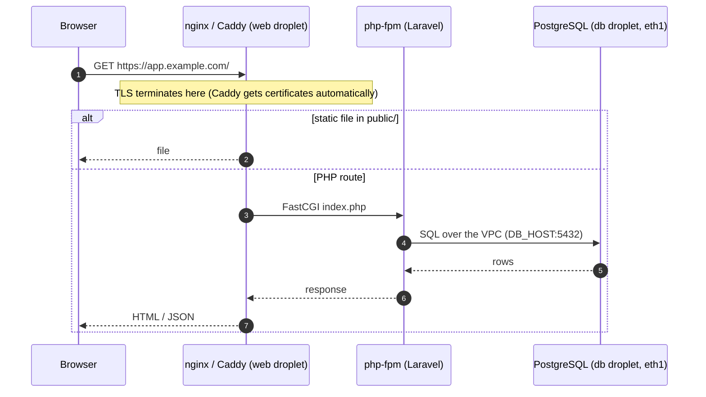

# Architecture

Two (or more) DigitalOcean droplets in the same region and VPC, managed with
[Ploi](https://ploi.io). The reference deployment runs in Atlanta.

## Contents

- [Overview diagram](#overview-diagram)
- [Request flow](#request-flow)
- [Network: eth0 vs eth1](#network-eth0-vs-eth1)
- [Ports and services](#ports-and-services)
- [Where things live](#where-things-live)

## Overview diagram

- **Web server**: a Ploi server, either native (nginx + PHP-FPM, deployed with
  [`ploi-deploy.sh`](deploy.md)) or Ploi's Docker server type with Caddy in
  front ([web-server-caddy.md](web-server-caddy.md)).
- **DB server**: a droplet provisioned through Ploi (so it has the `ploi`
  user) running the Docker stack from [`docker-db-server-manager.sh`](db-server.md).
  Every DB port is bound to the **private** IP only, and ufw allows only the VPC range.
- **Access**: one ed25519 key per host managed by sshmgr, user `ploi`, `sudo`
  with the password from Ploi's provisioning email ([ssh-access.md](ssh-access.md)).

## Request flow

## Network: eth0 vs eth1

On a DigitalOcean droplet:

| Interface | Addresses | Use |
|---|---|---|
| `eth0` | public IP **and** a `10.10.x.x` anchor IP | internet traffic; the anchor IP appears in the login banner and is normal |
| `eth1` | VPC private IP (e.g. `10.0.0.5`) | droplet-to-droplet traffic; this is `PRIVATE_IP` and the web app's `DB_HOST` |

Find the VPC IP with `ip -4 -o addr show eth1`.

## Ports and services

| Service | Droplet | Bind address | Port | Reachable from |
|---|---|---|---|---|
| nginx or Caddy | web | public | 80, 443 (+443/udp for HTTP/3 with Caddy) | internet |
| SSH | both | public | 22 | your workstation |
| PostgreSQL | db | eth1 | `PG_PORT` 5432 | VPC (`VPC_CIDR`) |
| PgBouncer | db | eth1 | `PGBOUNCER_PORT` 6432 | VPC |
| MySQL | db | eth1 | `MYSQL_PORT` 3306 | VPC |
| MariaDB | db | eth1 | `MARIADB_PORT` 3307 | VPC |

## Where things live

| What | Where |
|---|---|
| DB stack and generated `.env` with passwords | db: `/opt/db` (`.env` chmod 600) |
| Non-secret stack settings | db: `/opt/db/stack.env` |
| DB backups | db: `/opt/db/backups/<YYYYmmdd-HHMMSS>/` (daily at 03:15 server time, newest 7 kept) |
| Manager script and config | db: `/root/docker-db-server-manager.sh`, `/etc/docker-db-server-manager.conf` |
| Laravel site (native) | web: `/home/ploi/<site>/` |
| Shared `.env` and `storage/` | web: `/home/ploi/<site>-shared/` |
| Docker applications (Ploi) | web: `/home/ploi/containers/<name>/` |
