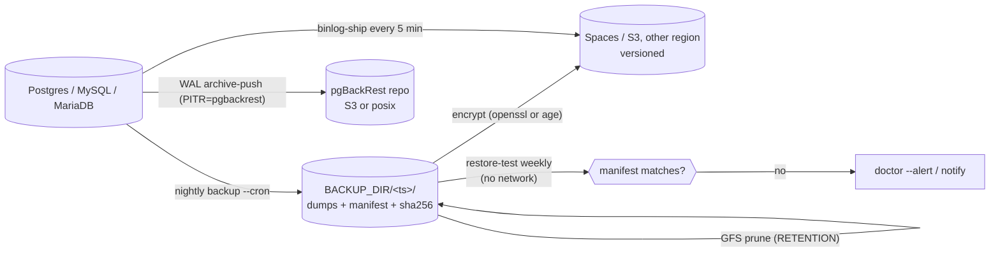
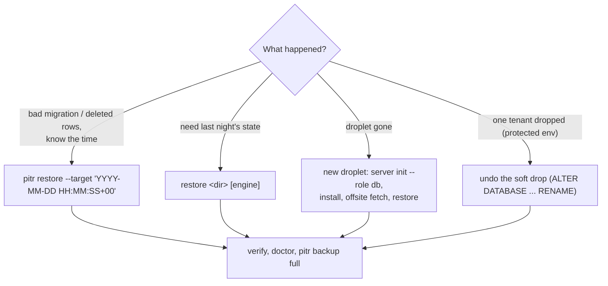

# Backups and recovery

The layers the DB manager (1.4.0) uses so that one mistake, one disk or one droplet can't lose data, and the
commands to restore from each. Keys are in [configuration keys](reference/configuration-keys.md#backups-gfs-retention-pitr-off-site-restore-tests-alerts).

> RPO/RTO figures below are estimates for a small database (a few GB). Measure yours with a restore drill.

## Layers



| Layer | Command / key | Stops | Default |
|---|---|---|---|
| Logical dumps | `backup` (`CRON_TIME`, 03:15 server time) | bad deploys, deleted rows | on |
| Manifest + checksums | written by `backup`, checked by `restore`, `restore-test`, `offsite verify` | silent corruption, truncated dumps | on |
| GFS retention | `RETENTION="daily=14 weekly=8 monthly=12 yearly=2"` (empty = newest `KEEP`) | running out of history | `KEEP=7` |
| Off-site, encrypted | `OFFSITE=s3`, `OFFSITE_ENCRYPTION=openssl\|age`, `offsite backup\|list\|verify\|fetch` | droplet loss, ransomware on the host | off until configured |
| Point-in-time recovery | `PITR=pgbackrest` (2.60+), `pitr setup\|backup\|status\|restore` | losing up to a day of writes | off |
| MySQL/MariaDB binlogs | `binlog-ship` (`BINLOG_SHIP_CRON`, every 5 min) | the same, for MySQL/MariaDB | with `OFFSITE` |
| Restore tests | `restore-test` (`RESTORE_TEST_CRON`, Sunday 05:00) | backups that don't restore | weekly |
| Protected-env guard | `--force-prod`, fresh backup, soft drop | the right command on the wrong env | `stg prd` |
| Alerts | `doctor --alert` hourly; `ALERT_EMAIL`, `ALERT_WEBHOOK`, `HEALTHCHECK_URL`, `ALERT_COMMAND` | failures nobody sees | none set |
| Snapshot | `upgrade` offers a DO snapshot first | failed upgrades | offered |

## Retention

Suggested GFS settings per environment (one server = one `RETENTION`; split servers for different policies):

| Env | PITR window | Daily | Weekly | Monthly | Yearly |
|---|---|---|---|---|---|
| prd | 14 days | 14 | 8 | 12 | 2 |
| stg | 7 days | 7 | 4 | 3 | 0 |
| trn | none | 7 | 4 | 0 | 0 |
| tst, dev | none | 3 | 0 | 0 | 0 |

Preview what a policy keeps without deleting anything (backup names newest first on stdin, kept names out):

```sh
ls -1r /opt/db/backups | sudo /root/docker-db-server-manager.sh gfs-keep "daily=7 weekly=4 monthly=3"
```

## Recovery targets (estimates)

| Setup | Data loss (RPO) | Time to recover (RTO) |
|---|---|---|
| Nightly dumps only | up to 24 h | 30-60 min |
| + off-site copies | up to 24 h, survives droplet loss | 45-90 min (new droplet + fetch) |
| + pgBackRest PITR | about 1 min | 15-45 min |
| prd on managed Postgres + standby | seconds on failover; PITR for mistakes | under 1 min for failover |

## Set up

```sh
# on the DB server, as root
install -d -m 700 /etc/vps-server-workbench
openssl rand -base64 48 > /etc/vps-server-workbench/backup.key && chmod 600 /etc/vps-server-workbench/backup.key
# copy the key somewhere safe OFF this server (password manager); without it the off-site copies are useless
(umask 077; cat > /etc/vps-server-workbench/offsite.env) <<'CREDS'
OFFSITE_ACCESS_KEY=<spaces key scoped to the bucket>
OFFSITE_SECRET_KEY=<secret>
CREDS
# in /etc/docker-db-server-manager.conf
#   OFFSITE=s3  OFFSITE_ENDPOINT=https://ams3.digitaloceanspaces.com  OFFSITE_BUCKET=myapp-db-backups
#   RETENTION="daily=14 weekly=8 monthly=12 yearly=2"   PITR=pgbackrest   ALERT_EMAIL=ops@example.com
sudo /root/docker-db-server-manager.sh upgrade --dry-run && sudo /root/docker-db-server-manager.sh upgrade
sudo /root/docker-db-server-manager.sh pitr setup          # stanza, check, first full backup
sudo /root/docker-db-server-manager.sh backup              # dumps, manifest, GFS prune, off-site copy
sudo /root/docker-db-server-manager.sh offsite verify      # download, checksum, decrypt, verify
sudo /root/docker-db-server-manager.sh restore-test        # load into throwaway containers, compare
sudo /root/docker-db-server-manager.sh cron-install        # all jobs below
```

`cron-install` writes `/etc/cron.d/docker-db-server-backup`:

| Job | When | Notes |
|---|---|---|
| `backup --cron` | `CRON_TIME` | always |
| `doctor --alert` | `DOCTOR_CRON` (hourly at :07) | alerts on problems |
| `restore-test --cron` | `RESTORE_TEST_CRON` | exit 1 and an alert on mismatch |
| `pitr backup full` / `diff` | `PITR_FULL_CRON` / `PITR_DIFF_CRON` | only with `PITR=pgbackrest` |
| `binlog-ship` | `BINLOG_SHIP_CRON` | only with `OFFSITE` and MySQL/MariaDB on |
| `purge-trash` | 04:40 | only with `APP` set |

Turn on bucket versioning, and give the server a key that can't delete objects if the provider supports it, so
a compromised server can't erase its own off-site history.

## Restore



| Situation | Commands |
|---|---|
| Restore last night's dump | `restore /opt/db/backups/<ts> postgres` (type `RESTORE`; protected envs also need `--force-prod` and the env name) |
| Point in time (Postgres) | `pitr restore --target '2026-10-31 09:14:00+00'` restores the **whole cluster**; then `verify`, `doctor`, `pitr backup full` |
| Droplet lost | `server init --role db`, copy the manager and config, `install`, put the key back, `offsite list`, `offsite fetch <name>`, `restore <dir> all` |
| Soft-dropped database | the undo line printed by `drop-db`: `ALTER DATABASE "<db>__trash_<ts>" ALLOW_CONNECTIONS true; ALTER DATABASE ... RENAME TO "<db>";` |
| Dropped MySQL/MariaDB database | `gunzip -c $BACKUP_DIR/dropped/<db>-<ts>.sql.gz \| docker compose exec -T mysql mysql -uroot -p` |

Practise a restore monthly on a scratch droplet ([checklist](checklists/monthly-restore-drill.md)).

## What isn't covered

- A PITR restore can't target one database: it rewinds every database on the Postgres server. To recover one
  table, restore to a scratch server and copy the rows back.
- MySQL/MariaDB point-in-time replay from shipped binlogs is manual (`mysqlbinlog --stop-datetime`).
- Not container-tested: PITR restore end to end, MySQL 9.7 restore tests (the integration test uses
  MariaDB 11). See [tests](../tests/README.md).
