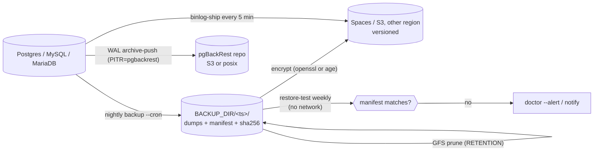
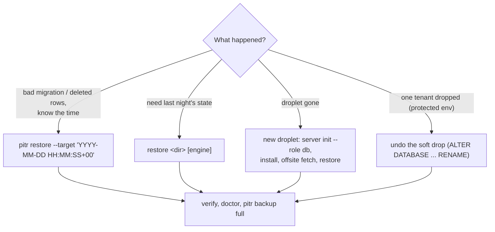

# Backups and recovery

The layers the DB manager (1.4.0) uses so that one mistake, one disk or one droplet can't lose data, and the
commands to restore from each. Keys are in [configuration keys](reference/configuration-keys.md#backups-gfs-retention-pitr-off-site-restore-tests-alerts).

> RPO/RTO figures below are estimates for a small database (a few GB). Measure yours with a restore drill.

## Layers



| Layer | Command / key | Stops | Default |
|---|---|---|---|
| Logical dumps | `backup` (`CRON_TIME`, 03:15 server time) | bad deploys, deleted rows | on |
| Manifest + checksums | written by `backup`, checked by `restore`, `restore-test`, `offsite verify` | silent corruption, truncated dumps | on |
| GFS retention | `RETENTION="daily=14 weekly=8 monthly=12 yearly=2"` (empty = newest `KEEP`) | running out of history | `KEEP=7` |
| Off-site, encrypted | `OFFSITE=s3`, `OFFSITE_ENCRYPTION=openssl\|age`, `offsite backup\|list\|verify\|fetch` | droplet loss, ransomware on the host | off until configured |
| Point-in-time recovery | `PITR=pgbackrest` (2.60+), `pitr setup\|backup\|status\|restore` | losing up to a day of writes | off |
| MySQL/MariaDB binlogs | `binlog-ship` (`BINLOG_SHIP_CRON`, every 5 min) | the same, for MySQL/MariaDB | with `OFFSITE` |
| Restore tests | `restore-test` (`RESTORE_TEST_CRON`, Sunday 05:00) | backups that don't restore | weekly |
| Protected-env guard | `--force-prod`, fresh backup, soft drop | the right command on the wrong env | `stg prd` |
| Alerts | `doctor --alert` hourly; `ALERT_EMAIL`, `ALERT_WEBHOOK`, `HEALTHCHECK_URL`, `ALERT_COMMAND` | failures nobody sees | none set |
| Snapshot | `upgrade` offers a DO snapshot first | failed upgrades | offered |

## Retention

Suggested GFS settings per environment (one server = one `RETENTION`; split servers for different policies):

| Env | PITR window | Daily | Weekly | Monthly | Yearly |
|---|---|---|---|---|---|
| prd | 14 days | 14 | 8 | 12 | 2 |
| stg | 7 days | 7 | 4 | 3 | 0 |
| trn | none | 7 | 4 | 0 | 0 |
| tst, dev | none | 3 | 0 | 0 | 0 |

Preview what a policy keeps without deleting anything (backup names newest first on stdin, kept names out):

```sh
ls -1r /opt/db/backups | sudo /root/docker-db-server-manager.sh gfs-keep "daily=7 weekly=4 monthly=3"
```

## Recovery targets (estimates)

| Setup | Data loss (RPO) | Time to recover (RTO) |
|---|---|---|
| Nightly dumps only | up to 24 h | 30-60 min |
| + off-site copies | up to 24 h, survives droplet loss | 45-90 min (new droplet + fetch) |
| + pgBackRest PITR | about 1 min | 15-45 min |
| prd on managed Postgres + standby | seconds on failover; PITR for mistakes | under 1 min for failover |

## Set up

```sh
# on the DB server, as root
install -d -m 700 /etc/vps-server-workbench
openssl rand -base64 48 > /etc/vps-server-workbench/backup.key && chmod 600 /etc/vps-server-workbench/backup.key
# copy the key somewhere safe OFF this server (password manager); without it the off-site copies are useless
(umask 077; cat > /etc/vps-server-workbench/offsite.env) <<'CREDS'
OFFSITE_ACCESS_KEY=<spaces key scoped to the bucket>
OFFSITE_SECRET_KEY=<secret>
CREDS
# in /etc/docker-db-server-manager.conf
#   OFFSITE=s3  OFFSITE_ENDPOINT=https://ams3.digitaloceanspaces.com  OFFSITE_BUCKET=myapp-db-backups
#   RETENTION="daily=14 weekly=8 monthly=12 yearly=2"   PITR=pgbackrest   ALERT_EMAIL=ops@example.com
sudo /root/docker-db-server-manager.sh upgrade --dry-run && sudo /root/docker-db-server-manager.sh upgrade
sudo /root/docker-db-server-manager.sh pitr setup          # stanza, check, first full backup
sudo /root/docker-db-server-manager.sh backup              # dumps, manifest, GFS prune, off-site copy
sudo /root/docker-db-server-manager.sh offsite verify      # download, checksum, decrypt, verify
sudo /root/docker-db-server-manager.sh restore-test        # load into throwaway containers, compare
sudo /root/docker-db-server-manager.sh cron-install        # all jobs below
```

`cron-install` writes `/etc/cron.d/docker-db-server-backup`:

| Job | When | Notes |
|---|---|---|
| `backup --cron` | `CRON_TIME` | always |
| `doctor --alert` | `DOCTOR_CRON` (hourly at :07) | alerts on problems |
| `restore-test --cron` | `RESTORE_TEST_CRON` | exit 1 and an alert on mismatch |
| `pitr backup full` / `diff` | `PITR_FULL_CRON` / `PITR_DIFF_CRON` | only with `PITR=pgbackrest` |
| `binlog-ship` | `BINLOG_SHIP_CRON` | only with `OFFSITE` and MySQL/MariaDB on |
| `purge-trash` | 04:40 | only with `APP` set |

### PITR repository on S3

pgBackRest's S3 driver speaks **HTTPS only**, so `validate` refuses an `http://` `OFFSITE_ENDPOINT` when
`PITR_REPO_TYPE=s3`. The repo uses `OFFSITE_ENDPOINT`, `OFFSITE_BUCKET`, `OFFSITE_REGION` and the keys in
`OFFSITE_CREDS_FILE`; `PITR_CIPHER_PASS` in the same file encrypts the repo (aes-256-cbc) before it leaves the server.

| Provider | `OFFSITE_ENDPOINT` | `PITR_S3_URI_STYLE` | `PITR_S3_CA_FILE` | Why |
|---|---|---|---|---|
| DigitalOcean Spaces | `https://<region>.digitaloceanspaces.com` (for example `ams3`) | `host` (default) | empty | Spaces serves `<bucket>.<region>...` with a public certificate; set `OFFSITE_REGION` to the same region |
| AWS S3 | `https://s3.<region>.amazonaws.com` | `host` | empty | public CA, virtual-hosted buckets |
| Garage / MinIO / SeaweedFS (self-hosted) | `https://s3.internal:8443` behind a TLS proxy | `path` | the proxy's CA (PEM) | no wildcard DNS for bucket hosts; a private CA is verified, never skipped |

A port in the endpoint becomes `repo1-storage-port`; the CA is copied to `postgres/conf/s3-ca.crt` and mounted
read-only. `offsite` (rclone or aws on the host) trusts the same CA (`RCLONE_CA_CERT` / `AWS_CA_BUNDLE`). A private
name that is not in DNS goes in the host's `/etc/hosts` for `offsite` and in `PITR_S3_HOST_IP` for pgBackRest: Docker's
DNS ignores the host's `/etc/hosts`, so the manager adds an `extra_hosts` entry to the postgres service.
Turning PITR on is `PITR=pgbackrest` plus `upgrade` (the image gains pgBackRest), then `pitr setup`; the upgrade's
doctor treats the not-yet-created stanza as a warning. Use a key scoped to the PITR bucket and keep `PITR_REPO_PATH` distinct per server
(`/db-main`, `/db-staging`) so two stanzas never share a path.

Make sure the endpoint resolves and answers from the DB server **before** `install` with `PITR=pgbackrest`:
Postgres runs `archive_command` from its first boot. A reachable repo without a stanza fails each push at once
(harmless: the WAL waits for `pitr setup`), but a name that does not resolve or a port that drops packets can
make each push wait out pgBackRest's timeout. The first boot's shutdown then runs past 60 s and `install` stops
at the health wait. `pitr-s3-it` hit this when its TLS front joined the network after `install`.

Turn on bucket versioning, and give the server a key that can't delete objects if the provider supports it, so
a compromised server can't erase its own off-site history.

## Restore



| Situation | Commands |
|---|---|
| Restore last night's dump | `restore /opt/db/backups/<ts> postgres` (type `RESTORE`; protected envs also need `--force-prod` and the env name) |
| Point in time (Postgres) | `pitr restore --target '2026-10-31 09:14:00+00'` restores the **whole cluster**; then `verify`, `doctor`, `pitr backup full` |
| Point in time (MySQL/MariaDB) | `binlog-replay --target '2026-10-31 09:14:00' [--engine mysql\|mariadb]` (UTC): newest dump before T, then the binlogs up to T ([below](#mysqlmariadb-point-in-time-binlog-replay)) |
| Droplet lost | `server init --role db`, copy the manager and config, `install`, put the key back, `offsite list`, `offsite fetch <name>`, `restore <dir> all` |
| Soft-dropped database | the undo line printed by `drop-db`: `ALTER DATABASE "<db>__trash_<ts>" ALLOW_CONNECTIONS true; ALTER DATABASE ... RENAME TO "<db>";` |
| Dropped MySQL/MariaDB database | `gunzip -c $BACKUP_DIR/dropped/<db>-<ts>.sql.gz \| docker compose exec -T mysql mysql -uroot -p` |

Practise a restore monthly on a scratch droplet ([checklist](checklists/monthly-restore-drill.md)).

## What isn't covered

- A PITR restore can't target one database: it rewinds every database on the Postgres server. To recover one
  table, restore to a scratch server and copy the rows back.
- `binlog-replay` replays from the shipped copies in `$BACKUP_DIR/binlogs/<engine>` (it runs `binlog-ship` first);
  after losing the droplet, put the off-site copies back there first. It skips account
  statements (users, grants, passwords): accounts stay as they are now.
- Tested: PITR restore to a time from a posix repo (`pitr-it`), from an S3 repo (`pitr-s3-it`, Garage behind
  TLS), from a real Spaces bucket (`pitr-spaces-live`, [live tests](live-tests.md)), and MySQL/MariaDB binlog
  replay (`mysql-pitr-it`). See [tests](../tests/README.md).

### MySQL/MariaDB point in time (binlog replay)

```sh
./docker-db-server-manager.sh binlog-replay --prepare                       # MySQL: build the decoder image now
./docker-db-server-manager.sh binlog-replay --target '2026-10-31 09:14:00'  # UTC, type RESTORE
./docker-db-server-manager.sh binlog-replay --target '2026-10-31 09:14:00' --engine mariadb --from /opt/db/backups/<ts>
```

1. Picks the newest backup that **finished** before the target (`backup` records each dump's binlog file and
   position, `--source-data`/`--master-data`, and its UTC finish time); `--from` picks one by hand.
2. Verifies its checksums, ships the binlogs off-site (`binlog-ship`), checks the binlogs from the dump's
   position on are all still there (a gap stops it), and takes a safety `backup`.
3. Drops the user databases, loads the dump and replays the binlogs from that position up to the target with
   binary logging off for the session, then flushes the logs and takes a fresh `backup`.

Protected environments need `--force-prod` and the env name. The binlogs from the dump's position to the target
must all be there: the server keeps them `BINLOG_DAYS` (default 7), so ship them (cron) and keep backups newer than that. MySQL images ship without `mysqlbinlog`: the first replay (or
`--prepare`) builds `vsw-local/mysqlbinlog:<tag>` from `MYSQL_IMAGE` plus Oracle's client RPM of the same version,
checking its signature; offline servers set `MYSQLBINLOG_IMAGE` to an image that has it. Replication GTIDs are
not reused (`--skip-gtids`; dumps carry `--set-gtid-purged=OFF`), so the replayed transactions get new GTIDs.
