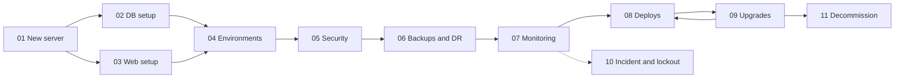

# Checklists

One checklist per phase of a server's life. Copy the one you need into the ticket or your notes and tick it
there. Every row has the **command**, how to **verify** it worked, and **why** it matters.

Conventions:

- `M` is the DB manager on the DB server: `sudo /root/docker-db-server-manager.sh`. `bin/siwo` runs on your
  workstation (never paste workstation commands into a server shell: see [lessons](../lessons-learned.md#ssh-and-access)).
- `<db>` / `<web>` are ssh aliases; `<client>` is the gitignored `local/<client>/` folder.
- Plan first: every write has `--dry-run` (or prints a plan and asks). Read the plan, then run it for real.
- Protected environments (prd by default) need `--force-prod`, the env name typed and a fresh verified backup.

| # | Checklist | Use it when |
|---|---|---|
| 01 | [New server](01-new-server.md) | a bare droplet: pick size and region, first login, init, first inventory |
| 02 | [DB setup](02-db-setup.md) | turning a droplet into the database server |
| 03 | [Web setup](03-web-setup.md) | a Ploi web server for a Laravel site |
| 04 | [Environments](04-environments.md) | adding tst/dev/trn/stg/prd databases, users and `.env` files |
| 05 | [Security hardening](05-security-hardening.md) | after setup, and every quarter |
| 06 | [Backups and DR](06-backups-and-dr.md) | backups, off-site copies, PITR, restore tests |
| 07 | [Monitoring](07-monitoring.md) | alerts for CPU, memory, disk, uptime and missed backups |
| 08 | [Deploys](08-deploys.md) | every deploy of the app |
| 09 | [Upgrades](09-upgrades.md) | OS updates and reboots, DB manager upgrades, resizes, engine changes |
| 10 | [Incident and lockout](10-incident-and-lockout.md) | the site is down, the DB is unreachable, or you can't log in |
| 11 | [Decommission](11-decommission.md) | retiring a server or an environment |
| - | [Pre-launch](pre-launch.md) | before real users or paying customers arrive |
| - | [Monthly restore drill](monthly-restore-drill.md) | proving the backups restore, every month |
