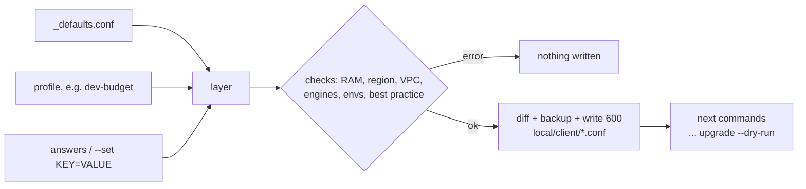

# Configure a setup (profiles and the wizard)

`bin/workbench configure` turns a **profile** (a tested starting point) plus your answers into the config files
for one client, checks them, and prints the commands to roll them out. It runs on your workstation, writes only
to the git-ignored `local/<client>/` folder, never writes secrets and never touches a server.



## Pick a profile

| Profile | Use it for |
|---|---|
| `dev-budget` | development + staging on 2 GB droplets: Postgres + PgBouncer only, off-site backups, DO Spaces |
| `staging` | a single stg that mirrors production |
| `production-single` | production on one hardened 4 GB+ DB droplet with PITR, TLS, alerts (`STRICT=1`) |
| `production-ha` | load balancer, 2 web nodes, managed DB, Spaces |
| `mysql-app` | a Laravel app on MySQL |
| `multi-engine` | Postgres, MySQL and MariaDB on one 4 GB droplet |
| `cross-region-wireguard` | web and DB in different regions |

Every setting and what each profile changes: [profiles reference](reference/profiles.md).

```bash
bin/workbench profile list
bin/workbench profile diff dev-budget production-single
```

## Run the wizard

```bash
bin/workbench configure                     # asks: profile, client, app, region, envs, RAM, IP, storage, PDF, email
```

Press Enter to keep the value in brackets. At the end you can add any other `KEY=VALUE`, one per line.

Without prompts (scripts, CI, or when you know the values):

```bash
bin/workbench configure --non-interactive --profile dev-budget --client acme \
  --set APP=shop --set DB_PRIVATE_IP=10.10.0.5 --set VPC_CIDR=10.10.0.0/16 --set OFFSITE_BUCKET=acme-backups \
  --dry-run                                  # checks and diffs only; drop --dry-run to write
```

Change one thing later and keep the earlier answers:

```bash
bin/workbench configure --non-interactive --client acme --keep --set RETENTION="daily=14 weekly=8" --yes
```

## What it checks

- **RAM per node**: the enabled engines, pgBackRest and the add-ons placed on each node against the droplet
  size (estimates in the [reference](reference/profiles.md#ram-estimates-used-by-the-checks)); over 100% is an
  error that names the DO size to use, over 85% a warning. Object storage on a 2 GB web node is flagged.
- **Region and network**: a real DO region; `VPC_CIDR` is private; `DB_PRIVATE_IP` lies inside it; a peer
  region only with WireGuard (VPCs are regional), and the WireGuard subnet inside `VPC_CIDR`.
- **Engines and envs**: at least one engine; PgBouncer and PITR need Postgres; tenant envs are in `ENVS`; prd on
  this droplet must be protected.
- **Best practice** (warnings, errors with `STRICT=1`): prd sharing a droplet, prd without PITR or TLS, backups
  only on the droplet, no alert email.
- **Safety**: values with quotes, `$`, backticks or newlines are refused (the files are sourced by bash);
  RustFS (experimental) is refused with prd or strict profiles; storage on the web role with 2+ web nodes is refused.

## What it writes

| File | Goes to | Notes |
|---|---|---|
| `local/<client>/workbench.conf` | stays local | every resolved setting with where it came from (`# profile`, `# override`) |
| `local/<client>/db-server.conf` | `/etc/docker-db-server-manager.conf` | only the manager keys; merged into an existing file, so hand-added keys (e.g. `PG_IMAGE`) stay |
| `local/<client>/addons-<role>.conf` | `/etc/vsw-addons.conf` on that node | only when an add-on is placed on that role |

Files are mode 600 in a 700 folder. A changed file is backed up first (`*.bak.<timestamp>`, git-ignored) and the
diff is shown; an existing file is only overwritten after you answer `yes` (or with `--yes`). A folder inside the
repo that git would track is refused. No passwords or keys are ever written: the manager and `addon.sh` create
them on the server.

## Roll it out

configure prints these with your paths filled in; the last step shows every change before anything happens:

```bash
scp local/acme/db-server.conf DB_HOST:/tmp/db-server.conf
ssh DB_HOST 'sudo cp -p /etc/docker-db-server-manager.conf /etc/docker-db-server-manager.conf.bak.$(date +%Y%m%d-%H%M%S) 2>/dev/null; sudo install -m 600 -o root -g root /tmp/db-server.conf /etc/docker-db-server-manager.conf && rm /tmp/db-server.conf'
ssh -t DB_HOST 'sudo /root/docker-db-server-manager.sh upgrade --dry-run'
```

Then run the same command without `--dry-run` (it asks before each change). Turning an engine off on a server
that has data in it: run `engine-disable <engine>` first, see the [DB manager](tools/db-server-manager.md).
