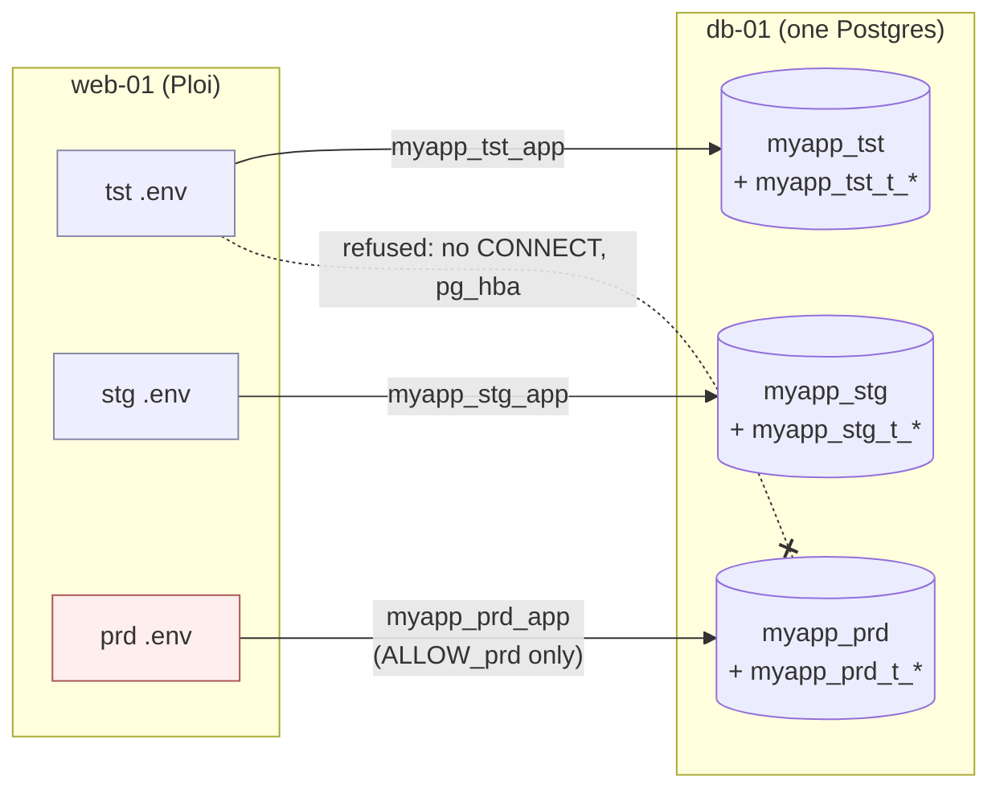
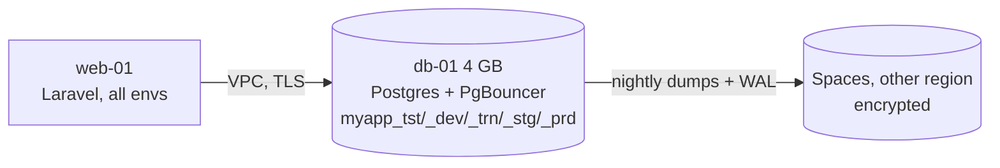
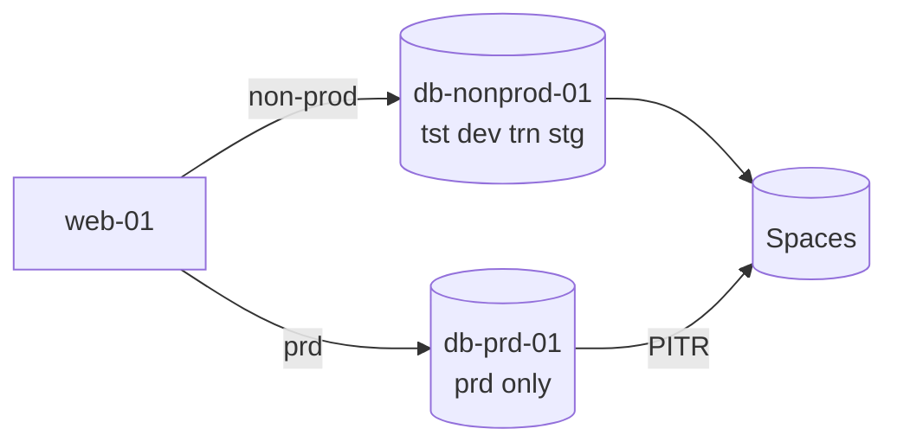
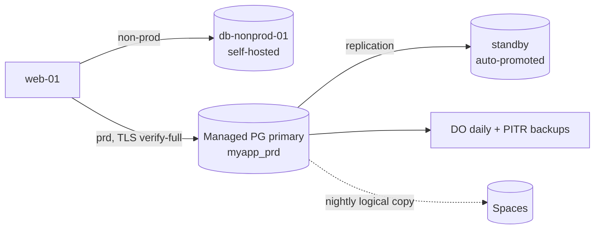
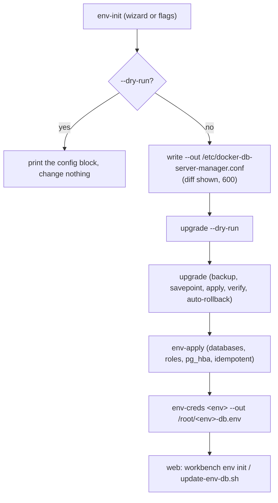

# Database environments (tst, dev, trn, stg, prd)

How the DB manager (1.4.0) runs several environments of one app on one server, what keeps them apart, the
topologies to grow into, and how to set it up. The names are in [naming](reference/naming.md), the privileges
in [privileges](reference/privileges.md), backups in [Backups and recovery](backups-and-recovery.md) and the
uptime options in [High availability](high-availability.md).

> **Estimates.** Prices, RAM and uptime figures on this page are estimates (DigitalOcean list prices,
> Oct 2026, and planning numbers from [sizing](reference/sizing.md)). Check the current price list before
> you buy, and measure before you resize.

## Contents

- [Short answer](#short-answer)
- [How isolation works](#how-isolation-works)
- [Topologies](#topologies)
- [Guard rails](#guard-rails)
- [Set it up](#set-it-up)
- [prd on another host](#prd-on-another-host)
- [What doctor checks](#what-doctor-checks)

## Short answer

- Same contract on every engine (names, roles, guard rails, backups, doctor checks), but turn on only the
  engines the app uses. Postgres is the default; MySQL and MariaDB are off unless the app needs them.
- MongoDB is off by design ([ADR 0009](adr/0009-mongodb-off-by-default.md)): Postgres `jsonb` covers flexible
  documents, and Mongo can't limit runtime tenant creation to a name prefix.
- Start with everything on one hardened 4 GB server (topology A). Move prd to managed Postgres with a
  standby (topology C) before real customers arrive ([ADR 0008](adr/0008-database-topology.md)).
- No setup gives 100%. Plan for about 99.9% on one server and 99.95% for the database once prd is managed.

## How isolation works



| Layer | What it does |
|---|---|
| Separate database per env | `<app>_<env>`, created by `env-apply` and owned by the admin, so the app can't drop it |
| Separate logins per env | `_app`, `_ro`, optional `_migrator`; `_owner` (no login) owns schema `public` |
| `REVOKE ALL ... FROM PUBLIC` | a login can only connect to databases it was granted |
| `pg_hba.conf` per env | each env's roles may only log in from `ALLOW_<env>` (default `VPC_CIDR`), and only to `^<app>_<env>(_t_...)?$` |
| MySQL/MariaDB grants | on `` `myapp_prd`.* `` and `` `myapp\_prd\_t\_%`.* `` only; no global privileges |
| Tenant prefix | the app role gets `CREATEDB` (Postgres) or the prefix grant (MySQL) only for envs in `TENANT_ENVS`; `doctor` flags any database outside the prefix |
| Secrets per env | `$ENV_SECRETS_DIR/<env>.env` (0600), generated once, printed only by `env-creds` |

Postgres caveat: a role that creates a database owns it and can drop it, and Postgres has no way to stop
that. In protected envs, soft-delete tenants in the app and let the manager purge (`drop-db` renames to
`__trash_<ts>`, `purge-trash` drops after `TRASH_DAYS`).

## Topologies

| | Scenario | Cost / month (estimate) | Blast radius | Realistic prd DB uptime (estimate) | Complexity |
|---|---|---|---|---|---|
| A | Everything on one server | ~$29 (4 GB droplet + Spaces) | every env | 99.5-99.9% | Low |
| B | Non-prod shared, prd on its own droplet | ~$53 | prd separate from tests | 99.5-99.9% | Low |
| **C** | **prd on managed Postgres + standby** | **~$90** | **prd fails over** | **99.95% (DO SLA)** | **Low** |
| D | Self-hosted primary + replica + automatic failover (Patroni) | $100+ and your time | survives a node loss | 99.95-99.99% if drilled | High |
| E | Per-env containers on one host | $48+ (8 GB) | every env (same host) | 99.5-99.9% | Medium |

Cost basis (estimates): 4 GB droplet $24, 8 GB $48, managed Postgres 2 GB ~$30.45 per node (primary +
standby ~$61), Spaces $5.

### A. Everything on one server (start here)



Cheapest and simplest; fine while there's no real customer data. A heavy test can slow prd, and one disk
failure takes every env down.

### B. Non-prod shared, prd on its own droplet



Same scripts as today: run the manager on both servers with different `ENVS` (`PRD_LOCATION=droplet` on the
non-prod server). prd is still one node.

### C. prd on DigitalOcean Managed Databases (recommended before launch)



`PRD_LOCATION=managed` on the self-hosted server; `env-sql prd` prints the SQL to create the prd roles on the
managed cluster (no superuser there, so the manager never connects to it). Limits: DO chooses extension
versions, and MariaDB isn't offered.

### D. Self-hosted HA

```mermaid
flowchart LR
  web[web-01] --> px[HAProxy / PgBouncer<br/>routes to leader]
  px -- writes --> p1[(pg-prd-01<br/>leader)]
  p1 -- WAL stream --> p2[(pg-prd-02<br/>replica)]
  etcd[etcd x3] -. leader election .-> p1
  etcd -. .-> p2
  p1 -- WAL + backups --> s3[(Spaces<br/>pgBackRest repo)]
```

Not automated by this repo (see [High availability](high-availability.md)). Only worth it if managed
Postgres turns out too limiting.

### E. Per-env containers on one host

Each env gets its own Postgres container. It lets envs run different versions, but costs about five times the
RAM and has the same blast radius as A. Not supported by the manager; use separate servers (B) instead.

**Phased plan:** A (hardened, 4 GB) now -> C for prd before paying customers -> two web nodes behind a load
balancer when the web tier matters -> D only if C is too limiting.

## Guard rails

| Guard | Applies to | Behaviour |
|---|---|---|
| Typed confirmation | all envs | `drop-db`, `drop-user` and `restore` ask you to type a word; `--yes` skips it on non-protected envs |
| Protected envs (`PROTECTED_ENVS`, default `stg prd`) | drop, restore, reset, uninstall --purge | refused without `--force-prod`; then type the env name (or `WORKBENCH_CONFIRM=<env>` without a terminal) |
| Fresh backup | protected envs | a verified backup younger than `FRESH_BACKUP_MIN` (15) minutes, taken automatically if missing |
| Soft drop | protected envs | Postgres: rename to `<db>__trash_<ts>` with connections off, purge after `TRASH_DAYS` (7). MySQL/MariaDB: a verified dump kept `DROPPED_DUMP_DAYS` (30), then drop |
| Least privilege | all envs | no superuser app logins, no `root@'%'`, the app can't drop its central database |
| Unprotected prd | config | `validate_envs` warns on every run if prd is in `ENVS` but not in `PROTECTED_ENVS` |

## Set it up



On the DB server, from a reviewed plan:

```sh
sudo /root/docker-db-server-manager.sh env-init --dry-run \
  --app myapp --engines postgres --envs tst,dev,stg,prd \
  --tenant-dbs tst,dev,stg,prd --protect stg,prd --prd-location local \
  --pitr pgbackrest --offsite s3 --tls require --alert-email ops@example.com \
  --allow prd=10.10.0.21/32 --allow default=10.10.0.0/24
# looks right? write it, then roll it out
sudo /root/docker-db-server-manager.sh env-init --out /etc/docker-db-server-manager.conf <same flags>
sudo /root/docker-db-server-manager.sh upgrade --dry-run
sudo /root/docker-db-server-manager.sh upgrade
sudo /root/docker-db-server-manager.sh env-apply
sudo /root/docker-db-server-manager.sh env-list
(umask 077; sudo /root/docker-db-server-manager.sh env-creds prd --out /root/prd-db.env)
```

| Wizard question | Flag | Default | Validation |
|---|---|---|---|
| App name | `--app` | from config | `^[a-z][a-z0-9]{1,19}$` |
| Engines | `--engines` | `postgres` | postgres, mysql, mariadb; mongodb is refused with the reason |
| Environments | `--envs` | `tst,dev,stg,prd` | known names only, at least one |
| Tenant databases | `--tenant-dbs` | same as envs | env list or `none` |
| Protected envs | `--protect` | `stg,prd` | env list or `none`; warns if prd is unprotected |
| Where prd lives | `--prd-location` | `local` | `local`, `droplet`, `managed` |
| Point-in-time recovery | `--pitr` | `pgbackrest` when Postgres is on | `off`, `pgbackrest` |
| Off-site copies | `--offsite` | `s3` | `none`, `s3` |
| TLS on the VPC | `--tls` | `require` | `off`, `require` |
| Alerts | `--alert-email` | `none` | an address or `none` |
| Client IPs | `--allow env=CIDR` (repeat) | `VPC_CIDR` | a known env or `default`, and a valid CIDR |

Without a terminal, a missing required answer (the app name) exits 2; nothing is guessed silently. The written
block has no secrets: passwords are generated by `env-apply` into `$ENV_SECRETS_DIR/<env>.env`.

On the web server, write the matching Laravel `.env` (see [Laravel .env](tools/env.md)).

## prd on another host

With `PRD_LOCATION=droplet` or `managed`, this server skips prd. `env-sql prd [engine]` prints idempotent SQL
for an admin to run on the prd host; it never includes passwords (set them with `\password`).

```sh
sudo /root/docker-db-server-manager.sh env-sql prd postgres > /root/prd-roles.sql
psql "host=db-prd.internal.example.com port=25060 user=doadmin sslmode=verify-full sslrootcert=ca.crt" -f /root/prd-roles.sql
```

## What doctor checks

| Area | Check | If it fails |
|---|---|---|
| Config | valid `APP`, known envs, `TENANT_ENVS` within `ENVS` | the command stops |
| Roles | only `PG_ADMIN_USER` is superuser; the app login has no admin attributes; `CREATEDB` matches the tenant setting | problem |
| Isolation | `PUBLIC` can't connect; the central database is owned by an admin; each env database exists | problem (warn for `PUBLIC`) |
| Tenants | an env's app role owns only `<app>_<env>_t_*`; read-only roles have no write grants | problem |
| Naming | every `<app>_*` database matches the contract | warn |
| MySQL/MariaDB | no `root@'%'`, `local_infile=0`, `secure_file_priv` set, no global privileges or `GRANT OPTION`, `_` escaped in grants | problem (warn for unescaped `_`) |
| Network | DB ports on the VPC IP only; `pg_hba` has no open or trust rules | problem |
| TLS | on when `TLS_MODE=require`; certificate valid for more than 21 days | problem |
| Backups | newest dump under `BACKUP_MAX_AGE_H`; off-site copy as fresh; WAL archived within the hour | problem + alert |
| Restore tests | one passed within `RESTORE_TEST_MAX_AGE_D` days | warn |
| Capacity | disk under 80% (warn) / 90% (problem), `DOCTOR_DISK_WARN_PCT` / `DOCTOR_DISK_BAD_PCT`; RAM vs [sizing](reference/sizing.md) | warn |

`doctor --alert` (hourly from `cron-install`) sends failures to `ALERT_EMAIL`, `ALERT_WEBHOOK`,
`HEALTHCHECK_URL` or `ALERT_COMMAND`.
