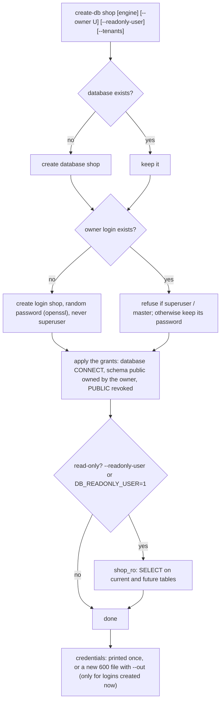

# Database users and privileges

How the DB manager (`src/shell/db/docker-db-server-manager.sh`, 1.6.0+) creates databases and logins, links
them, and which settings control it. The per-privilege table is in [Privileges](../reference/privileges.md);
the reasons are in [ADR 0010](../adr/0010-least-privilege-database-roles.md). Connecting a DB client from your
workstation is in [Connecting local DB clients](connecting-local-clients.md).

## The three kinds of login

| Login | One per | Name | Used by | Can |
|---|---|---|---|---|
| **Master (admin)** | engine | `PG_ADMIN_USER` (default `vsw_admin`), `MYSQL_ADMIN_USER` / `MARIADB_ADMIN_USER` (default `siwo_admin`) | you, your DB client, the manager | everything (`SUPERUSER` on Postgres; `MY_ADMIN_PRIVS` on `*.*` on MySQL/MariaDB) |
| **Owner (app)** | database | the database name (`create-db shop` makes login `shop`), or `--owner U` | the application (`DB_USERNAME`) | DDL and DML in its own database only; never a superuser |
| **Read-only** (optional) | database | `<owner>_ro` | reporting, support, analysts | `SELECT` in that database only |

Extra logins for an existing database come from `create-user <user> <db> [--readonly|--readwrite]`, and an
existing login gets another database with `grant`. `root` on MySQL/MariaDB still exists but only for
`localhost`, `127.0.0.1` and the Docker network: the manager uses it inside the container, you use the master.

## How a database and its owner are created



On Postgres the database itself is owned by `PG_ADMIN_USER`, so the app cannot drop it; the owner login owns
schema `public` and gets `CONNECT, TEMPORARY`. On MySQL/MariaDB the owner gets `MY_OWNER_PRIVS` on
`` `shop`.* `` only. PgBouncer finds new Postgres logins at once (`auth_query`); it refuses superusers, so the
Postgres master always connects on the direct port (5432), never 6432.

### Re-running is safe (idempotent)

`create-db` and `create-user` only create what is missing:

- an existing database is kept (its data is never touched); an existing login keeps its password and only its
  grants are re-applied. The output says `already existed: grants re-applied, password unchanged`;
- no credentials file is written for a login that already existed (a new password needs
  `rotate-password <user> [engine] --out FILE`);
- an existing Postgres database whose schema `public` belongs to another login is refused, as is an owner that
  is a superuser or one of the master logins.

So a deploy script or runbook can call `create-db shop` every time.

## Master users

- **Postgres:** `PG_ADMIN_USER` is the bootstrap superuser created by `install`. Keep `vsw_admin` on servers
  installed before 1.6.0; renaming the superuser later is not supported. `pg_hba` allows it only from the
  Docker network and `VPC_CIDR`, over TLS when `TLS_MODE` is on.
- **MySQL/MariaDB:** `MYSQL_ADMIN_USER` / `MARIADB_ADMIN_USER` (default `siwo_admin`; `none` = no master, use
  root on the server). The manager creates it on every converge (`install`, `upgrade`, `engines apply`) as
  `user@<cidr>` for each entry of `MY_ADMIN_HOSTS` (default: the Docker network and `VPC_CIDR`; `0.0.0.0/0`
  and `%` are refused), drops hosts no longer listed, re-syncs its password from `/opt/db/.env` and grants
  `MY_ADMIN_PRIVS` (default `ALL PRIVILEGES`) on `*.*`, with `GRANT OPTION` when `MY_ADMIN_GRANT_OPTION=1`.
  `root` is refused as a master name.
- **Passwords:** generated on the server (`openssl rand -hex 24`) the first time a key is written to
  `/opt/db/.env` (600) and never overwritten afterwards. A value passed to the manager as
  `PG_ADMIN_PASSWORD`, `MYSQL_ADMIN_PASSWORD` or `MARIADB_ADMIN_PASSWORD` (or the `SIWO_DB_` form) seeds a key
  that does not exist yet; it must match `[A-Za-z0-9._-]{16,128}`. The manager never prints them.
- **Reading one:** `admin-creds <postgres|mysql|mariadb> --out FILE` writes `DB_HOST`, `DB_PORT`,
  `DB_USERNAME`, `DB_PASSWORD` to a new 600 file (it refuses to overwrite one and never prints the password).
  Copy the values into your DB client or your workstation `.env`, then delete the file.

```bash
sudo /root/docker-db-server-manager.sh admin-creds mysql --out /root/mysql-admin.creds
sudo /root/docker-db-server-manager.sh create-db shop postgres --readonly-user --out /root/shop.creds
sudo /root/docker-db-server-manager.sh create-db shop postgres          # again: nothing new, grants re-applied
sudo /root/docker-db-server-manager.sh create-user shop_report shop --readonly
sudo /root/docker-db-server-manager.sh list-users all
```

## Settings

All keys live in `/etc/docker-db-server-manager.conf` (see `config/db-server.env.example` and
[Configuration keys](../reference/configuration-keys.md)); the environment overrides the file. Every key can
also be written `SIWO_DB_<KEY>`, the form the workstation `.env` uses; a plain `<KEY>` wins over it.

| Key | Default | What |
|---|---|---|
| `PG_ADMIN_USER` | `vsw_admin` | Postgres master (superuser) |
| `MYSQL_ADMIN_USER`, `MARIADB_ADMIN_USER` | `siwo_admin` | MySQL/MariaDB master; `none` disables |
| `MY_ADMIN_HOSTS` | Docker network + `VPC_CIDR` | CIDRs or IPs the MySQL/MariaDB master may log in from |
| `MY_ADMIN_PRIVS` | `ALL PRIVILEGES` | the master's privileges on `*.*` |
| `MY_ADMIN_GRANT_OPTION` | `1` | the master may grant (needed to manage other users from a client) |
| `PG_APP_CREATEDB` | `1` | the single-layout Postgres app login may create tenant databases |
| `DB_READONLY_USER` | `0` | `1` = every `create-db` also makes `<name>_ro` |
| `MY_APP_HOST` | `%` | host part of MySQL/MariaDB app users (ports listen on the private IP only) |
| `MY_OWNER_PRIVS`, `MY_RW_PRIVS`, `MY_RO_PRIVS` | see [Privileges](../reference/privileges.md#mysql-and-mariadb) | database-level privilege sets; `ALL`, `GRANT`, `FILE`, `SUPER`, `PROCESS`, `SHUTDOWN`, `RELOAD`, `REPLICATION`, `CREATE USER` are refused |

Passwords are never config keys: they live only in `/opt/db/.env` on the server.

### The workstation `.env`

`.env-example` (tracked) lists the `SIWO_DB_*` keys with empty passwords and `<placeholders>`; copy it to
`.env` (git-ignored, `chmod 600`). `make env-check` (part of `make ci`) and the `no-env-files` pre-commit hook
fail if a `.env` file is ever tracked or staged.

- `SIWO_DB_ENABLE_*`: the engine toggles, applied with `bin/siwo db engines` (below).
- `SIWO_DB_*_ADMIN_USER` / `_PASSWORD`: your record of the master logins. The server keeps the live passwords;
  sync your copy from `admin-creds`. No tool sends the passwords in this file to a server.
- `SIWO_DB_SSH_HOST` (`user@ip` or an ssh alias), `SIWO_DB_SSH_IDENTITY` (private key), `SIWO_DB_PRIVATE_IP`,
  `SIWO_DB_LOCAL_*`: used by `bin/siwo tunnels db-tunnel`, `remote-run.sh` and `bin/siwo db engines`.
- Every other `SIWO_DB_<KEY>` (`VPC_CIDR`, `PG_DB`, ...): the server config. `remote-run.sh` installs them as
  `/etc/docker-db-server-manager.conf` (no passwords, see [remote-run](../tools/remote-run.md#the-server-config)).
  This replaces `local/<client>/db-server.conf`: env files live in the repo root only.

## Turning engines on and off

`ENABLE_POSTGRES`, `ENABLE_PGBOUNCER`, `ENABLE_MYSQL`, `ENABLE_MARIADB`, `ENABLE_ADMINER` (`1`/`0`). A
disabled engine has no container, port, firewall rule, backup or check. `engines apply` changes only the
services whose setting changed; the others keep their containers and are not restarted, so turning MySQL and
MariaDB off on a Postgres server causes no Postgres downtime.

```bash
sudo /root/docker-db-server-manager.sh engines                                   # status (read-only)
sudo /root/docker-db-server-manager.sh engines apply --set ENABLE_MYSQL=0 --set ENABLE_MARIADB=0 --dry-run
sudo /root/docker-db-server-manager.sh engines apply --set ENABLE_MYSQL=0 --set ENABLE_MARIADB=0   # type APPLY
```

`apply` prints the plan, asks you to type `APPLY` (`--yes` skips it), takes a backup when a data engine is
stopped, stops and removes only those containers, writes the setting to the config file(s), starts and converges
the engines turned on, prunes their firewall rules, checks that the untouched containers are the same ones
and runs `doctor`. Data volumes are kept: turning an engine back on brings its data and users back.
`--purge` deletes the volumes of every engine that is off, after a typed `DELETE-<volume>` (or
`WORKBENCH_CONFIRM='DELETE <volume>'`). `engine enable|disable <engine>` is the one-engine form.

### Where the setting lives on the server

The manager reads `/etc/docker-db-server-manager.conf` and then `/opt/db/.env`; **`/opt/db/.env` wins** for any
key it holds. Many servers have no `/etc` file at all and keep every setting in `/opt/db/.env`; that file is
then the live config. `engines apply` writes `ENABLE_*` to whichever file already holds the key (both if both
do; `/opt/db/.env` if neither does), with a dated `.bak-*` copy, and does nothing to a file that already has
the value. `engines` (status) prints which files it reads.

It is also idempotent against changes made by hand. If an engine is already `0` and its container already
gone (e.g. the setting was edited and the container removed with `docker rm`), the plan does not try to stop
it again; it shows only what is left:

```text
  files   regenerate docker-compose.yml: mysql mariadb off, container already gone, still listed
  ufw     remove the 3306/tcp rule
```

and a second run says `nothing to change`. The walkthrough of a live change done by hand, with the docker-only
path, checks, re-enable and purge, is in
[rehearsals/2026-11-engines-off-live.md](../rehearsals/2026-11-engines-off-live.md).

### Re-enabling and purging

```bash
sudo /root/docker-db-server-manager.sh engines apply --set ENABLE_MYSQL=1 --dry-run    # plan
sudo /root/docker-db-server-manager.sh engines apply --set ENABLE_MYSQL=1              # same volume: data and users come back
sudo /root/docker-db-server-manager.sh engines apply --purge --dry-run                 # which volumes of off engines would go
```

`--purge` deletes the data volumes (`db_mysql_data`, `db_mariadb_data`) of the engines that are off, after a
backup and a typed `DELETE-<volume>`. Do it only once you are sure the data is not needed; until then the
volumes cost disk, not RAM.

### From the workstation

From the workstation, `bin/siwo db engines` reads the toggles from `.env` and runs the same thing through
`remote-run.sh` (it uploads this checkout's manager unless `--no-upload`):

```bash
bin/siwo db engines status
bin/siwo db engines plan                 # engines apply --dry-run on the server
bin/siwo db engines apply                # the server asks you to type APPLY
bin/siwo db engines plan --print         # show the remote-run command only
bin/siwo db engines apply --host <user>@<db-public-ip> -i ~/.ssh/<db-key> --expect-ip <db-private-ip>
bin/siwo db engines plan --no-config     # leave the server's config files alone (only engines apply edits them)
```

The repo-root `.env` is read line by line (never sourced): `SIWO_DB_ENABLE_*` become the `--set` arguments,
`SIWO_DB_SSH_HOST`, `SIWO_DB_SSH_IDENTITY` and `SIWO_DB_PRIVATE_IP` the connection (`--host`, `-i`,
`--expect-ip` override them), and the other server keys the uploaded config (`--config FILE` overrides,
`--no-config` skips; see [remote-run](../tools/remote-run.md)). A toggle missing from the file is not sent.
If sudo on the server needs a password, run it in a terminal: sudo asks once, in its own prompt
([details](../tools/remote-run.md#sudo)).

The same as a direct remote-run call (`--dry-run` before `--` prints it and connects to nothing; `--dry-run`
after the manager command is the manager's plan on the server):

```bash
src/shell/db/remote-run.sh --dry-run --host <user>@<db-public-ip> -i ~/.ssh/<db-key> --expect-ip <db-private-ip> -- engines apply --set ENABLE_MYSQL=0 --set ENABLE_MARIADB=0
src/shell/db/remote-run.sh --host <user>@<db-public-ip> -i ~/.ssh/<db-key> --expect-ip <db-private-ip> -- engines apply --set ENABLE_MYSQL=0 --set ENABLE_MARIADB=0 --dry-run
src/shell/db/remote-run.sh --host <user>@<db-public-ip> -i ~/.ssh/<db-key> --expect-ip <db-private-ip> -- engines apply --set ENABLE_MYSQL=0 --set ENABLE_MARIADB=0
```

PgBouncer needs Postgres, so `ENABLE_POSTGRES=0` with `ENABLE_PGBOUNCER=1` is refused.
