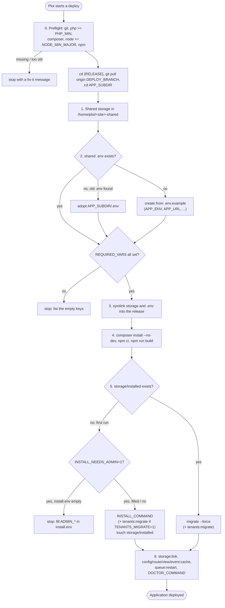

# Deploy script (Ploi, native PHP)

[`scripts/deploy/ploi-deploy.sh`](../scripts/deploy/ploi-deploy.sh) is a
zero-downtime deploy script for a Laravel app on a native (non-Docker) Ploi
server. Edit its `SETTINGS` block and paste it into the site's deploy script
in Ploi. Example settings:
[`examples/myapp/ploi-deploy.settings.sh`](../examples/myapp/ploi-deploy.settings.sh).

## Contents

- [Pipeline](#pipeline)
- [Settings](#settings)
- [First run](#first-run)
- [Ploi placeholder caveat](#ploi-placeholder-caveat)

## Pipeline

## Settings

| Setting | Default | Meaning |
|---|---|---|
| `SITE_DOMAIN` | `example.com` | Ploi site domain; also the folder name in `/home/ploi` |
| `APP_ENV_NAME` | `production` | `APP_ENV` written into a new shared `.env` |
| `DEPLOY_BRANCH` | `main` | branch pulled into the release |
| `APP_SUBDIR` | `src` | Laravel root inside the repository (`.` if top level) |
| `PHP_MIN` / `NODE_MIN_MAJOR` | `8.5.0` / `22` | preflight minimums |
| `INSTALL_COMMAND` | `php artisan migrate --force` | runs once, on the first deploy |
| `INSTALL_NEEDS_ADMIN` | `0` | `1`: read `ADMIN_NAME/EMAIL/PASSWORD` from `<shared>/install.env` and pass them as `--admin-*` |
| `TENANTS_MIGRATE` | `0` | `1`: also run `tenants:migrate --force` |
| `DOCTOR_COMMAND` | empty | optional health check after caching |
| `REQUIRED_VARS` | `APP_URL DB_HOST DB_PORT DB_DATABASE DB_USERNAME DB_PASSWORD` | keys that must be non-empty before deploying continues |
| `TENANCY_DOMAIN_KEY` | empty | key set to `SITE_DOMAIN` in a new `.env` (e.g. `TENANCY_CENTRAL_DOMAINS`) |
| `SHARED`, `OLD_ENV` | `/home/ploi/<site>-shared`, `/home/ploi/<site>/<APP_SUBDIR>/.env` | can be overridden from the environment |

## First run

The first deploy usually stops twice, on purpose:

1. **Empty `.env` keys.** Fill the `DB_*` values with
   [`update-env-db.sh`](web-server-ploi.md#update-db_-settings) and the rest in Ploi's
   environment editor (after the [symlink](web-server-ploi.md#shared-env)), then deploy again.
2. **Administrator** (only with `INSTALL_NEEDS_ADMIN=1`). Fill
   `/home/ploi/<site>-shared/install.env` and deploy again. The file is
   `shred`-deleted after a successful install.

The queue worker and scheduler run as Ploi daemons ([daemons.md](daemons.md));
`queue:restart` makes them load the new release. Don't also enable a
`schedule:run` cron.

## Ploi placeholder caveat

Ploi replaces its placeholders (`{RELEASE}`, `{BRANCH}`, `{SITE}` and others)
in the deploy script text **before** bash runs it, comments included. A shell
variable written as `${BRANCH}` therefore becomes `$main`, and with `set -u`
the deploy dies with `main: unbound variable`. The script only uses
`{RELEASE}`, on purpose (`cd {RELEASE}`), and names its own variables
`DEPLOY_BRANCH`, `SITE_DOMAIN` and so on. The smoke test
(`make test`) fails if a placeholder name is used as a shell variable.
