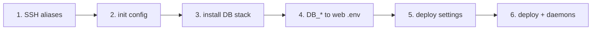

# New project in 10 minutes

From two fresh Ploi droplets in one DigitalOcean VPC to a deployed app. The
placeholders are: project `myproject`, site `app.example.com`, SSH aliases
`myproject-web` / `myproject-db`, DB private IP `10.0.0.5`. A filled-in set of
files for this made-up project is in
[`examples/generic-laravel/`](../examples/generic-laravel/README.md).



**1. SSH** ([ssh-access.md](ssh-access.md)). One key per host, added in Ploi for user `ploi`:

```sh
ssh myproject-db whoami && ssh myproject-web whoami      # both: ploi
```

**2. DB config.** `init` detects the private IP and VPC range and prints a config with no secrets:

```sh
mkdir -p examples/myproject     # or anywhere outside the repo
ssh myproject-db 'bash -s -- init' < scripts/db/docker-db-server-manager.sh > examples/myproject/db-server.conf
```

Edit it: `PG_USER`/`PG_DB` (e.g. `myproject`), and switch off engines you don't
need (`ENABLE_MYSQL=0`, `ENABLE_MARIADB=0`, ...). All settings:
[`config/db-server.env.example`](../config/db-server.env.example).

**3. Install the DB stack**, with nightly backups, and print the `DB_*` lines:

```sh
scripts/db/remote-run.sh --host myproject-db --expect-ip 10.0.0.5 \
  --config examples/myproject/db-server.conf -- install, cron-install, doctor, env > ~/myproject-db.env
```

**4. Point the web server at it** (check reachability first; no passwords needed for that):

```sh
scripts/web/check-db-reach.sh --remote myproject-web 10.0.0.5
# keep only the DB_* lines from step 3's output in ~/myproject-db.env, then:
scripts/web/update-env-db.sh --remote myproject-web --site app.example.com --from ~/myproject-db.env
rm ~/myproject-db.env
```

**5. Deploy script.** Copy [`scripts/deploy/ploi-deploy.sh`](../scripts/deploy/ploi-deploy.sh),
set the SETTINGS block (`SITE_DOMAIN`, `PRESET=laravel` or `generic`, `APP_SUBDIR`,
any hooks; see [deploy.md](deploy.md#settings)) and paste it into Ploi →
site → Deploy script. Keep your SETTINGS block in `examples/myproject/` too.

**6. Deploy** in Ploi. If it stops, it says exactly which `.env` keys or
`install.env` values to fill. Then add the queue worker and scheduler daemons
([daemons.md](daemons.md)) and check the server with
`remote-run.sh ... -- doctor` and [security.md](security.md).

Not Laravel? Use `PRESET=generic` and set `BUILD_CMDS`, `FIRST_INSTALL_CMD`,
`MIGRATE_CMD` and `HEALTHCHECK_CMD` to whatever your app needs; every hook is optional.
