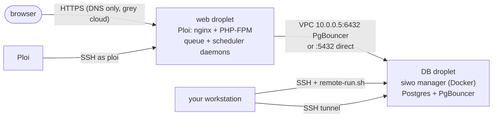

# Ploi + DigitalOcean: end-to-end setup

One Laravel app (a monorepo with the app in `src/`) on two DigitalOcean droplets: a **web** server
provisioned and deployed by Ploi, and a **database** server run by the DB manager (`siwo`). This page puts
the whole flow in order, with a checklist per stage and a troubleshooting section built from a real rollout.
The per-tool details live in the linked pages.

Placeholders used throughout (none of them are real):

| Placeholder | Meaning |
|---|---|
| `example.com` | your zone in Cloudflare |
| `app.example.com`, `stg.example.com` | the production and staging sites |
| `myapp-web`, `myapp-db` | SSH aliases for the two droplets (user `ploi`) |
| `10.0.0.5` | the DB server's private (VPC) IP; the web server is `10.0.0.4` |
| `203.0.113.10` | the web server's public IP |
| `10.0.0.0/20` | the VPC range |

## Contents

- [The shape](#the-shape)
- [1. DigitalOcean: droplets, VPC, firewall, SSH keys](#1-digitalocean-droplets-vpc-firewall-ssh-keys)
- [2. Provision the web server in Ploi](#2-provision-the-web-server-in-ploi)
- [3. The DB server with siwo](#3-the-db-server-with-siwo)
- [4. Connect the site to the database](#4-connect-the-site-to-the-database)
- [5. Ploi site settings](#5-ploi-site-settings)
- [6. Daemons: queue worker and scheduler](#6-daemons-queue-worker-and-scheduler)
- [7. Cloudflare DNS and certificates](#7-cloudflare-dns-and-certificates)
- [8. First deploy and verification](#8-first-deploy-and-verification)
- [Troubleshooting (real findings)](#troubleshooting-real-findings)
- [Lessons learned](#lessons-learned)

## The shape



- Same **region**, same **VPC**. DB traffic only ever uses the private IP ([architecture](../architecture.md)).
- Ploi owns the web server (nginx, PHP, ufw, Supervisor). The manager owns the DB server's Docker stack in
  `/opt/db`; don't create Ploi databases or Ploi Docker apps on it
  ([why](../recipes/configure-a-ploi-web-server.md#ploi-docker-servers)).

## 1. DigitalOcean: droplets, VPC, firewall, SSH keys

1. **Pick the region once** and use it for both droplets. Check which sizes Ploi offers there with
   `bin/siwo plans`.
2. **SSH keys: one key pair per host, created on your workstation.** The private key never leaves it. Upload
   the public key to the DO account only if you want DO to put it on new droplets:

   ```sh
   ssh-keygen -t ed25519 -C "myapp/myapp-db" -f ~/.ssh/myapp_myapp-db-ed25519
   bin/siwo keys account add --provider digitalocean --name myapp-db --key-file ~/.ssh/myapp_myapp-db-ed25519.pub --dry-run
   bin/siwo keys account list --provider digitalocean
   ```

   Keys in the DO account are only copied onto a droplet **when it is created**. Deleting one later does not
   remove it from a running droplet, and who can log in is decided by each server's `authorized_keys`
   (`bin/siwo keys server list --host ploi@<host>`). See [SSH access](../recipes/set-up-ssh-access.md).
3. **Droplets** on the newest Ubuntu LTS, in the VPC (`--image latest` asks the API for it):

   ```sh
   bin/siwo do vpcs
   bin/siwo do droplet-create myapp-db  --region <region> --size s-1vcpu-2gb --ssh-keys <key-id> --image latest --vpc <vpc-uuid> --tag myapp --dry-run
   bin/siwo do droplet-create myapp-web --region <region> --size s-1vcpu-2gb --ssh-keys <key-id> --image latest --vpc <vpc-uuid> --tag myapp --dry-run
   ```

   Or let Ploi create the droplets through its DigitalOcean integration; then check afterwards that both
   landed in the same region and VPC (`bin/siwo do droplets --tag myapp`).
4. **Cloud firewall.** Docker publishes ports past ufw, so the DO cloud firewall is the real gate on the DB
   server ([security](../security.md)):

   ```sh
   bin/siwo do firewall-apply db  --vpc <vpc-uuid> --ssh-from <your-ip>/32 --droplet <db-droplet-id> --dry-run
   bin/siwo do firewall-apply web --vpc <vpc-uuid> --droplet <web-droplet-id> --dry-run
   bin/siwo do firewalls        # WORLD-OPEN flags any non-web port open to everyone
   ```

5. **Snapshot before every risky change** on the DB server: `bin/siwo do snapshot <droplet-id> --name myapp-db-pre-change --wait`.
   This needs a token with write scope; a read-only token can list but not snapshot.

| ✔ | Check |
|---|---|
| ☐ | Both droplets in the same region and VPC, newest Ubuntu LTS |
| ☐ | One key pair per host, made locally, private keys only on your workstation |
| ☐ | Cloud firewall: DB ports only from the VPC, SSH only from your IPs |
| ☐ | A write-scoped DO token is at hand (or `doctl auth init`) for snapshots, revoked when you are done |

## 2. Provision the web server in Ploi

1. Ploi → **Servers → Create**: a server on the web droplet (through the DO integration, or a custom server
   by running Ploi's install command as root on the new droplet). Pick the PHP version the app needs.
2. Ploi installs its own key (`ploi-worker@ploi.io`) for user `ploi`. **Leave it**: without it Ploi can't
   manage the server. Add your per-host public key under the server's **SSH keys** page for user `ploi`.
3. Note the sudo password from Ploi's "server provisioned" email; the DB manager and most server tools need it.
4. Initialise and check it from your workstation (no Docker or ufw changes under Ploi):

   ```sh
   bin/siwo server init --host myapp-web --role web --dry-run
   bin/siwo server status --host myapp-web
   ```

The DB droplet can be added to Ploi the same way (it gets the `ploi` user, sudo and updates), but create
**no** sites or databases on it in Ploi.

## 3. The DB server with siwo

Full reference: [DB server manager](../tools/db-server-manager.md),
[users and privileges](../databases/users-and-privileges.md).

1. **Config**, generated on the server (it detects the private IP and VPC range), then copied into the
   git-ignored repo-root `.env` as `SIWO_DB_<KEY>=VALUE` (env files live in the repo root only; the
   template is `.env-example`). Also set the connection there: `SIWO_DB_SSH_HOST` (`user@public-ip` or an ssh
   alias), `SIWO_DB_SSH_IDENTITY` (private key) and `SIWO_DB_PRIVATE_IP`:

   ```sh
   ssh myapp-db 'bash -s -- init' < src/shell/db/docker-db-server-manager.sh   # print it, then copy each KEY=VALUE into .env as SIWO_DB_KEY=VALUE
   ```

   `remote-run.sh` turns those keys into the server's `/etc/docker-db-server-manager.conf` on every run (no
   passwords; [details](../tools/remote-run.md#the-server-config)). An older `local/<client>/db-server.conf`
   still works when passed with `--config`.

2. **Engine toggles: switch off what the app doesn't use before the first install.** A Postgres-only
   Laravel app needs `ENABLE_POSTGRES=1` and `ENABLE_PGBOUNCER=1`; set `ENABLE_MYSQL=0`, `ENABLE_MARIADB=0`
   and `ENABLE_ADMINER=0`. Every running engine costs RAM ([sizing](../reference/sizing.md)). Turning one off
   later is possible without Postgres downtime (`engines apply`, see
   [turning engines on and off](../databases/users-and-privileges.md#turning-engines-on-and-off)), but keep
   the same values in the root `.env` (`SIWO_DB_ENABLE_*`), or the next `install`/`upgrade` turns them back on.
   On the server, `/opt/db/.env` wins over the `/etc` file for every key it holds; a server set up by hand may
   have only `/opt/db/.env`, and `engines apply` then edits that file.
3. **Install** with nightly backups and print the `DB_*` lines for the app:

   ```sh
   src/shell/db/remote-run.sh -- install, cron-install, doctor          # host, key, IP and config from .env
   src/shell/db/remote-run.sh --host ploi@203.0.113.10 -i ~/.ssh/myapp-db --expect-ip 10.0.0.5 -- install, cron-install, doctor
   ```

   Put `--dry-run` **before** `--` to print the ssh line, sudo mode and remote script without connecting. If
   the login user's sudo needs a password, run it in a terminal: remote-run checks `sudo -n true` first and
   then lets sudo ask once over `ssh -t` (the password is never on a command line).

4. **Master login per engine.** Postgres: `PG_ADMIN_USER` (superuser). MySQL/MariaDB, when on: a named admin
   (default `siwo_admin`) allowed only from the Docker network and the VPC. Passwords are generated on the
   server into `/opt/db/.env` (600) and never printed; read one into a 600 file with
   `admin-creds <engine> --out FILE` when a DB client needs it.
5. **One owner login per app database**, never a superuser, plus an optional read-only login:

   ```sh
   sudo /root/docker-db-server-manager.sh create-db myapp_stg postgres --readonly-user --out /root/myapp_stg.creds
   sudo /root/docker-db-server-manager.sh create-db myapp_prd postgres --out /root/myapp_prd.creds
   ```

   Staging and production get **separate** databases and logins. `create-db` is idempotent: running it again
   re-applies grants and never changes an existing password. Multi-tenant apps that create databases at
   runtime need `CREATEDB` on the owner and a direct (5432) connection.

| ✔ | Check |
|---|---|
| ☐ | Unused engines off in the config **before** `install` (and in the root `.env`, `SIWO_DB_ENABLE_*`, forever after) |
| ☐ | `doctor` clean: ports bound to the private IP only, no superuser app login, TLS as configured |
| ☐ | A backup ran and is complete (`-- backup`), the nightly cron is installed |
| ☐ | One owner login per app database and environment; the credentials file deleted once copied |

## 4. Connect the site to the database

In the site's **shared** `.env` (Ploi's environment editor, once it points at the shared file; see
[shared `.env`](../recipes/configure-a-ploi-web-server.md#shared-env)):

| Key | Value | Notes |
|---|---|---|
| `DB_CONNECTION` | `pgsql` | |
| `DB_HOST` | `10.0.0.5` | the DB server's **private** IP; never its public IP |
| `DB_PORT` | `6432` (PgBouncer) or `5432` (direct) | see below |
| `DB_DATABASE`, `DB_USERNAME` | the owner from `create-db` | never the master login |
| `DB_PASSWORD` | from the credentials file | filled with `update-env-db.sh`, not pasted into chat or a ticket |
| `DB_SSLMODE` | `prefer`, `require` or `verify-full` | match the manager's `TLS_MODE` (`require` when TLS is on; `verify-full` with the CA, [recipe](../recipes/verify-full-tls.md)) |

**PgBouncer (6432) vs direct (5432).** Use PgBouncer for web requests and queue workers: it runs in
**session** mode, so Laravel works unchanged. Use 5432 for the master login (PgBouncer refuses superusers),
for DB clients, and for apps that run `CREATE DATABASE` at runtime (tenancy packages): give those a second
connection on 5432 or keep `DB_PORT=5432`.

```sh
bin/siwo web check-db-reach --remote myapp-web 10.0.0.5 6432 5432
src/shell/web/update-env-db.sh --remote myapp-web --site stg.example.com --from ~/myapp_stg.db.env
rm ~/myapp_stg.db.env
```

Redeploy afterwards: the config is cached at deploy time. Local DB clients (TablePlus, DBeaver, psql) go
through an SSH tunnel: [connecting local DB clients](../databases/connecting-local-clients.md).

## 5. Ploi site settings

| Setting | Value | Why |
|---|---|---|
| Web directory | `/src/public` for a monorepo with the app in `src/` (`/public` when the app is at the repo root) | Ploi's default `/public` makes nginx serve the repo root, not the app |
| PHP version | the version in `composer.json`'s `require.php` | site and CLI must match; the deploy's preflight checks `PHP_MIN` |
| Repository / branch | staging: your staging branch; production: `main` | one site per environment, never shared |
| Zero-downtime deployment | on | releases are built aside and swapped in |
| Deploy script | [`ploi-deploy.sh`](../tools/deploy-script.md) with `APP_SUBDIR=src`, `STAGE="main"` | see the order below |
| Post-deploy script | the same script and settings with `STAGE="post"` | `queue:restart` and health checks run after the swap |

**Deploy script order** (what `ploi-deploy.sh` does, [pipeline](../tools/deploy-script.md#pipeline)):

1. `cd {RELEASE}` then `cd src` (the app root).
2. Preflight: git, PHP version, composer, node.
3. Shared `.env`: create or adopt it in `/home/ploi/<site>-shared/`, stop if a required key
   (`APP_URL`, `DB_HOST`, `DB_PORT`, `DB_DATABASE`, `DB_USERNAME`, `DB_PASSWORD`) is empty, then link it and
   `storage/` into the release.
4. Build: `composer install --no-dev`, `npm ci && npm run build`.
5. First install once (`FIRST_INSTALL_CMD`, fed by `install.env` when `INSTALL_ENV_KEYS` is set), or
   `migrate --force` on every later deploy.
6. `storage:link`, `optimize` (caches built inside the release).
7. Ploi swaps the release live, then the post-deploy script runs `queue:restart`, `POST_DEPLOY_CMDS` and
   `HEALTHCHECK_CMD`.

**Shared files**, in `/home/ploi/<site>-shared/`, mode 600:

- `.env`: the app settings; survives every release. Point Ploi's editor at it with a symlink
  ([how](../recipes/configure-a-ploi-web-server.md#shared-env)).
- `install.env`: only for the first install (for example the first admin's name, email and password). Create
  it empty with `umask 077`, fill it, deploy; the script `shred`-deletes it after a successful install.

Never use `{BRANCH}`-style Ploi placeholders as shell variables
([caveat](../tools/deploy-script.md#ploi-placeholder-caveat)).

| ✔ | Check |
|---|---|
| ☐ | Web directory `/src/public` (monorepo) and nginx serves it |
| ☐ | PHP version matches `composer.json` |
| ☐ | Zero-downtime on; main script `STAGE="main"`, post-deploy script `STAGE="post"` |
| ☐ | Shared `.env` complete and 600; Ploi's editor shows it |
| ☐ | `install.env` filled before the first deploy if `INSTALL_ENV_KEYS` is set |
| ☐ | The deploy script contains no tokens (see [the GitHub token finding](#ploi-deploy-script-embeds-the-github-token)) |

## 6. Daemons: queue worker and scheduler

On the server's **Daemons** page ([details](../recipes/run-daemons.md)):

| Field | Queue worker | Scheduler |
|---|---|---|
| Command | `php artisan queue:work --tries=3` | `php artisan schedule:work` |
| Directory | `/home/ploi/<site>/src` | `/home/ploi/<site>/src` |
| User | `ploi` | `ploi` |
| Processes | 1 or more | exactly 1 |
| Environment | **empty** | **empty** |

Leave **Environment** empty. The app reads the symlinked shared `.env` on its own; Ploi writes this field
into Supervisor's `environment=` line, which only accepts `KEY="value"` pairs. A path such as `src/.env`
there makes Supervisor fail to parse its config and crash-loop (see
[troubleshooting](#supervisor-crash-loop-from-an-invalid-environment-line)). Don't also add a
`schedule:run` cron, or every task runs twice.

```sh
bin/siwo ploi daemons <server-id>
ssh myapp-web "sudo supervisorctl status; pgrep -af 'queue:work|schedule:work'"
```

## 7. Cloudflare DNS and certificates

**Records.** Point every hostname the app answers at the **web** server's public IP:

```sh
bin/siwo cf dns list example.com --type A
bin/siwo cf dns upsert example.com A stg.example.com 203.0.113.10 --dry-run
bin/siwo cf dns upsert example.com A '*.stg.example.com' 203.0.113.10 --dry-run
```

`upsert` without `--proxied` creates a **DNS only** (grey cloud) record. Delete any old record that points
at a previous droplet.

**Grey cloud for multi-level wildcard tenancy.** Cloudflare's free Universal SSL certificate covers
`example.com` and `*.example.com` only, one level deep. Tenant hosts such as `tenant1.stg.example.com` are two
levels deep, so a proxied (orange) record fails the TLS handshake at Cloudflare's edge. Either keep those
records DNS only and terminate TLS on the server, or buy Cloudflare's Advanced Certificate Manager for the
deeper wildcard.

**Wildcard certificate on the server.** Let's Encrypt issues wildcards only through the **DNS-01** challenge.
In Ploi → site → SSL, choose Let's Encrypt with the DNS (Cloudflare) verification, give it a Cloudflare API
token scoped to *Zone → DNS → Edit* for this zone only, and request
`stg.example.com,*.stg.example.com`. The HTTP challenge (`bin/siwo ploi cert-create`) only works for
non-wildcard names whose DNS already points at the server.

| ✔ | Check |
|---|---|
| ☐ | Every app hostname resolves to the web server (`dig +short stg.example.com`) |
| ☐ | Multi-level wildcard records are DNS only (grey) |
| ☐ | The certificate covers the apex and the wildcard (`openssl s_client -connect stg.example.com:443 -servername tenant1.stg.example.com`) |
| ☐ | The Cloudflare token used for DNS-01 is zone-scoped |

## 8. First deploy and verification

1. Press **Deploy** in Ploi (or `bin/siwo ploi deploy <server-id> <site-id>`). The first deploy may stop on
   purpose and name the empty `.env` keys or the missing `install.env` values; fill them and deploy again
   ([first run](../tools/deploy-script.md#first-run)).
2. Check:

   ```sh
   bin/siwo health https://stg.example.com/up
   bin/siwo web diagnose --host myapp-web --site stg.example.com --env stg
   ```

3. Production repeats sections 4 to 8 with its own site, branch `main`, its own database and owner login,
   and its own shared `.env`.

| ✔ | Check |
|---|---|
| ☐ | `/up` returns 200 through the real hostname |
| ☐ | `<shared>/.first-install-done` exists; migrations ran (the database has app tables) |
| ☐ | `supervisorctl status`: queue worker and scheduler `RUNNING`, uptime increasing |
| ☐ | `diagnose` exits 0 |
| ☐ | DB server: `remote-run.sh ... -- doctor` clean, last backup complete |

## Troubleshooting (real findings)

From a staging rollout that never came up. Each finding is generalised; the commands are read-only.

| Symptom | Cause | Fix |
|---|---|---|
| Every request returns 500; no `vendor/` and no linked `.env` in the release | [Deploys never completed](#deploys-never-completed-empty-db_password) | Fill the empty key, deploy again |
| Cloudflare error 522 | [Stale DNS](#stale-dns-causes-522) to an old droplet | Point the records at the current web server |
| Queue worker never runs; Supervisor restarted thousands of times | [Invalid `environment=` line](#supervisor-crash-loop-from-an-invalid-environment-line) | Clear the daemon's Environment field |
| Scheduled tasks never run | [No scheduler](#missing-scheduler) | Add a `schedule:work` daemon |
| `doctor` warns about a superuser app login | [App uses the master login](#app-uses-a-superuser-database-login) | `create-db` an owner login, switch the `.env` |
| A token is readable in the deploy script | [Ploi embeds the GitHub token](#ploi-deploy-script-embeds-the-github-token) | Revoke and reconnect; use a deploy key |
| `zsh: no such file or directory: db-alias` when running `remote-run.sh` | [A `<placeholder>` typed literally](#remote-run-placeholder-and-sudo-errors) | Use the real `user@ip` or set `SIWO_DB_SSH_HOST` |
| `sudo: a terminal is required` / `a password is required` from `remote-run.sh` | [sudo needs a password](#remote-run-placeholder-and-sudo-errors) | Run it in a terminal; sudo asks once |

### remote-run: placeholder and sudo errors

Turning MySQL and MariaDB off on a Postgres-only DB server failed twice before anything ran:

- `zsh: no such file or directory: db-alias`: the command was pasted with `--host <db-alias>`. Unquoted `<`
  and `>` are shell redirections, so the shell looked for a file called `db-alias` and never started the
  script. Fix: the real value (`--host ploi@203.0.113.10`), or `SIWO_DB_SSH_HOST` in `.env` and no `--host`.
  A quoted placeholder now stops remote-run with `--host is still a placeholder`.
- sudo needed the login user's password and the run had no terminal (`--dry-run` had been put **after**
  `--`, which is the manager's plan on the server and still needs sudo). Fix: `--dry-run` **before** `--`
  for a print-only run; for the real one, a terminal, where sudo asks once over `ssh -t`.

The working sequence:

```sh
src/shell/db/remote-run.sh --dry-run --host <user>@<db-public-ip> -i ~/.ssh/<db-key> --expect-ip <db-private-ip> -- engines apply --set ENABLE_MYSQL=0 --set ENABLE_MARIADB=0
src/shell/db/remote-run.sh --host <user>@<db-public-ip> -i ~/.ssh/<db-key> --expect-ip <db-private-ip> -- engines apply --set ENABLE_MYSQL=0 --set ENABLE_MARIADB=0 --dry-run
src/shell/db/remote-run.sh --host <user>@<db-public-ip> -i ~/.ssh/<db-key> --expect-ip <db-private-ip> -- engines apply --set ENABLE_MYSQL=0 --set ENABLE_MARIADB=0
```

Doing it by hand (no remote-run), checking it and undoing it:
[rehearsals/2026-11-engines-off-live.md](../rehearsals/2026-11-engines-off-live.md). All errors:
[remote-run troubleshooting](../tools/remote-run.md#troubleshooting).

### Deploys never completed: empty `DB_PASSWORD`

Several deploys in a row stopped at the required-keys check because the shared `.env` had an empty
`DB_PASSWORD`. The value was filled in a day later, but nobody deployed again, so the site sat on a release
with no `vendor/`, no `.env` link and no migrations, and every request was a 500.

- Check: the last deploy log in Ploi → site → Deployments; `ls <shared>/.first-install-done`;
  `grep -c '^DB_PASSWORD=.' <shared>/.env` (prints 1 when set, never the value).
- Fix: fill the key (`update-env-db.sh`), then **deploy again**. Editing `.env` never deploys by itself.

### Stale DNS causes 522

The site's A records (apex, landlord and wildcard) still pointed at a previous droplet with every port
closed. Cloudflare reached nothing and showed 522, which looked like a server failure.

- Check: `dig +short stg.example.com` against the web server's current public IP (`bin/siwo do droplets`).
- Fix: update every record (`cf dns upsert`), remove the old ones, and keep multi-level wildcards grey.

### Supervisor crash-loop from an invalid `environment=` line

The queue daemon's **Environment** field held a path (`src/.env`). Ploi wrote it into the Supervisor program
file as `environment=src/.env`, which Supervisor can't parse, so Supervisor itself exited and was restarted
by systemd about ten thousand times. No worker ever ran.

- Check: `systemctl status supervisor` (restart counter), `sudo journalctl -u supervisor -n 50`,
  `sudo grep -R '^environment=' /etc/supervisor/conf.d/`.
- Fix: edit the daemon in Ploi and clear Environment; then `sudo supervisorctl status` shows it `RUNNING`.

### Missing scheduler

Only a queue daemon existed, no scheduler, so nothing scheduled ever ran (and pages still rendered, which
hides it).

- Check: `pgrep -af 'schedule:work'`, `bin/siwo ploi crons <server-id>`.
- Fix: add a `php artisan schedule:work` daemon with the same user and directory (not a cron as well).

### App uses a superuser database login

The site's `.env` used the Postgres master login. That works until something goes wrong: the app can drop
any database, PgBouncer refuses superusers, and a leaked `.env` exposes the whole server.

- Check: `remote-run.sh ... -- doctor` on the DB server; `list-users postgres`.
- Fix: `create-db <name> postgres` for an owner login, put it in the shared `.env`, deploy. Keep the master
  for you and your DB client only.

### Ploi deploy script embeds the GitHub token

The generated deploy/clone commands on the web server contained the GitHub access token Ploi uses to pull
the repository, in plain text, readable by anyone with a shell as `ploi` and by any tool that prints the
script.

- Check, without printing it: `grep -c 'github.com' <deploy script>` and look for credentials in remote
  URLs with `git -C <site> remote -v | sed -E 's#//[^@/]*@#//***@#'`.
- Fix: revoke Ploi's GitHub access (GitHub → Settings → Applications), reconnect GitHub in Ploi, and prefer a
  read-only **deploy key** per repository. Never paste a deploy script into a chat, ticket or log unredacted.

## Lessons learned

1. **Deploy after every `.env` fix.** A filled-in key does nothing until the next deploy; "never deployed
   since" is the first thing to check on a 500.
2. **DNS before certificates, and DNS before blaming the server.** A 522 means Cloudflare can't reach the
   origin: check the record's IP first.
3. **Leave Ploi's daemon Environment field empty** for Laravel apps; the shared `.env` is enough.
4. **Two daemons, always:** `queue:work` and `schedule:work`.
5. **The app never uses the master login.** One owner login per database and environment.
6. **Switch unused engines off at install time** and keep the toggle in the local config, so a later upgrade
   doesn't turn them back on.
7. **Snapshot first, with a write-scoped token you revoke afterwards.** A read-only token can't snapshot;
   find that out before the change window, not during it.
8. **Monorepo = `/src/public`** web directory and `APP_SUBDIR=src`, in the site settings, the deploy script and
   the daemon directory alike.
9. **Grey cloud for multi-level wildcards**, with a DNS-01 Let's Encrypt wildcard on the server.
10. **Treat deploy scripts as secrets** until proven otherwise.

More rules from earlier work: [lessons learned](../lessons-learned.md). Related checklists:
[web setup](../checklists/03-web-setup.md), [DB setup](../checklists/02-db-setup.md),
[deploys](../checklists/08-deploys.md).
