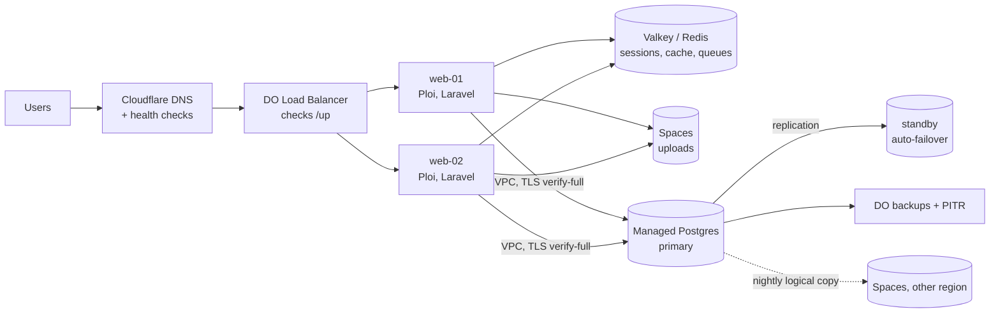

# High availability

What it takes to keep the app up when a droplet, a disk or a region fails, which parts this repo automates and
which are documented steps. Pick a profile with `bin/siwo configure` ([profiles](reference/profiles.md));
`production-ha` sets up the plan below. The database topologies are compared in
[Database environments](database-environments.md#topologies).

> Uptime, cost and recovery figures are estimates (DigitalOcean list prices and SLAs, Oct 2026). Whole-app
> uptime multiplies: a 99.95% database behind one 99.9% web droplet gives about 99.85%.

## Target architecture (`production-ha`)

| Uptime | Downtime per month | Downtime per year | What it takes |
|---|---|---|---|
| 99.5% | 3 h 39 min | 1.8 days | one droplet, careful maintenance |
| 99.9% | 43.8 min | 8.8 h | one droplet, short maintenance windows, fast restores |
| 99.95% | 21.9 min | 4.4 h | automatic database failover (managed standby or Patroni) |
| 99.99% | 4.4 min | 52.6 min | multiple nodes everywhere, zero-downtime deploys, someone on call |
| 100% | 0 | 0 | not achievable: providers, networks and people all fail sometimes |

## Building blocks

| Block | Automated here | How |
|---|---|---|
| Two web nodes + load balancer | partly: `configure` plans it, Ploi provisions | DO Load Balancer (~$12/month, estimate) on `/up`; same deploy script on both nodes; scheduler `->onOneServer()` |
| Shared state off the web nodes | docs | sessions, cache and queues in Valkey/Redis; uploads in Spaces (`FILESYSTEM_DISK=s3`); never local disk |
| Managed Postgres + standby | docs + `env-sql prd` | create the cluster in DO with one standby node; run the printed SQL as `doadmin`; `DB_SSLMODE=verify-full` with DO's CA |
| Self-hosted replica | not automated | see [Self-hosted primary + replica](#self-hosted-primary--replica) |
| Backups + PITR | yes | [Backups and recovery](backups-and-recovery.md) |
| Health checks | partly | Laravel `/up` checks the DB; external uptime monitor every minute; `doctor --alert` hourly |
| DNS failover | docs | apps use a private DNS name with a 60-300 s TTL, so a failover repoints one record; Cloudflare health checks on the public side |
| Maintenance window | yes | `server update` with a reboot window; no automatic reboots on DB hosts |
| Zero-downtime migrations | docs | expand then contract; `CREATE INDEX CONCURRENTLY`; `SET lock_timeout = '5s'`; batched backfills; MySQL `ALGORITHM=INSTANT` |

## Self-hosted primary + replica

`DB_MODE=replica` in a profile means you run the replica yourself; the manager doesn't build it. Outline
(Postgres 18, streaming replication):

1. Second DB droplet in the same VPC: `server init --role db`, `install` with the same config.
2. On the primary, a replication role and a `pg_hba` line for the replica's private IP only.
3. On the replica, stop Postgres, empty the data volume, `pg_basebackup -R -X stream -S replica1`, start it.
4. Check `pg_stat_replication` on the primary and `pg_is_in_recovery()` on the replica.
5. Failover by hand: `pg_ctl promote` on the replica, repoint the private DNS name, then rebuild the old primary
   as a replica. Automatic failover needs Patroni + etcd x3 (topology D): only worth it with someone to run it.

Rehearse the failover every quarter. An untested failover usually fails when you need it.

## Checklist

[Pre-launch checklist](checklists/pre-launch.md) has the HA items to tick before paying customers arrive.
