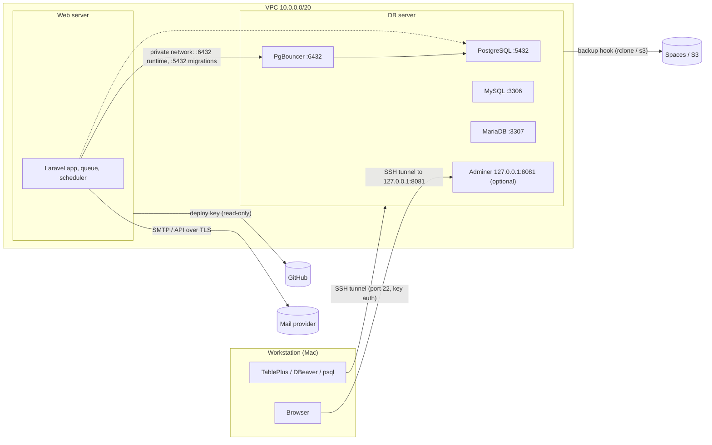

# Connections

Every way something talks to the database server, and how to do it securely. The rule behind all of it:
**database ports listen only on the DB server's private VPC IP, the admin UI listens only on `127.0.0.1`, and
nothing database-related is ever reachable on the public IP.** Docker-published ports bypass ufw, so the bind
address is the real protection; ufw is the second layer.

Examples below use `10.0.0.5` as the DB server's private IP, `10.0.0.0/20` as the VPC, `203.0.113.10` as its
public IP and `ploi` as the SSH user. Replace them with yours (`ip -4 -o addr show eth1` on the DB server).

## Overview



## Ports

| Service | Server port (default) | Bound to | Local tunnel port | Config key |
|---|---|---|---|---|
| PostgreSQL (direct) | 5432 | private IP | 15432 | `PG_PORT` |
| PgBouncer (session mode) | 6432 | private IP | 16432 | `PGBOUNCER_PORT` |
| MySQL | 3306 | private IP | 13306 | `MYSQL_PORT` |
| MariaDB | 3307 | private IP | 13307 | `MARIADB_PORT` |
| Adminer (optional) | 8081 | `127.0.0.1` only | 8081 | `ENABLE_ADMINER`, `ADMINER_PORT` |

Local ports are offset so they don't clash with databases running on the Mac (OrbStack, Homebrew, DBngin).
Confirm the live ports on the server with `sudo docker ps --format '{{.Names}}\t{{.Ports}}'`.

## 1. Mac GUI tools over SSH

Credentials: Postgres user, database and password come from `sudo ./docker-db-server-manager.sh env`.
MySQL and MariaDB root passwords live in `/opt/db/.env` (`sudo grep ROOT_PASSWORD /opt/db/.env`); better,
create a per-app or read-only user (`create-db`, `create-user ... --readonly`, see
[db-server.md](../tools/db-server-manager.md#create-db-name-engine)) and use that.

### TablePlus (built-in SSH)

New connection, pick the engine, tick **Over SSH**:

| Field | PostgreSQL | MySQL | MariaDB |
|---|---|---|---|
| Host | `10.0.0.5` | `10.0.0.5` | `10.0.0.5` |
| Port | `5432` | `3306` | `3307` |
| User / Database | from `env` | root or `create-db` user | root or `create-db` user |
| SSL mode | Disable (traffic is inside SSH) | Disable | Disable |
| Over SSH: server | `203.0.113.10`, port `22` | same | same |
| Over SSH: user | `ploi` | same | same |
| Over SSH: key | *Use SSH key* → your private key file | same | same |

TablePlus also accepts an `~/.ssh/config` alias's key; it does not read `ProxyJump`. Use the PgBouncer port
`6432` instead of `5432` only to test exactly what the app sees.

DBeaver: connection → *SSH* tab → *Use SSH Tunnel*, same values. DataGrip: *SSH/SSL* tab, same values.

### Any tool, with a tunnel

```bash
# Postgres + MySQL + MariaDB + Adminer in one tunnel (Ctrl-C closes it)
shell/tunnels/db-tunnel.sh --host ploi@203.0.113.10 --private-ip 10.0.0.5 all

# or by hand, one engine
ssh -N -L 15432:10.0.0.5:5432 ploi@203.0.113.10
```

Then connect to `127.0.0.1`:

```bash
psql "host=127.0.0.1 port=15432 user=app dbname=app"
mysql -h 127.0.0.1 -P 13306 -u root -p
mariadb -h 127.0.0.1 -P 13307 -u root -p
```

`db-tunnel.sh` options: engines `postgres pgbouncer mysql mariadb adminer all`; `--background`; `--print`
(show the ssh command only); local ports via `LOCAL_PG`, `LOCAL_MYSQL`, ... (see `--help`). It binds the local
ends to `127.0.0.1`, so nothing else on your Wi-Fi can use the tunnel.

## 2. Admin web UI (Adminer, optional)

**Choice: [Adminer](https://www.adminer.org)** (official Docker image `adminer:6.1.2-standalone`, pinned).
One small PHP app that manages MySQL, MariaDB and PostgreSQL (plus SQLite, MS SQL, Oracle) from a single
login screen, actively maintained (6.x releases through 2026), about 40 MB, no state to back up.

| Tool | MySQL/MariaDB | PostgreSQL | Notes |
|---|---|---|---|
| **Adminer** | yes | yes | one tiny container, stateless; login = DB credentials |
| phpMyAdmin | yes | no | MySQL/MariaDB only |
| pgAdmin 4 | no | yes | Postgres only; heavier, has its own user store |
| CloudBeaver CE | yes | yes | full web DBeaver, Java, ~400 MB, own user/admin store to secure and back up |
| AdminerEvo | yes | yes | fork made while Adminer was dormant; upstream Adminer is active again, so prefer it |

Security model:
- Off by default (`ENABLE_ADMINER=0`). When on, Compose publishes it on `127.0.0.1:${ADMINER_PORT}` only:
  not on the private IP, not public, no ufw rule is added. `doctor` flags it if it ever listens elsewhere.
- Reached only through an SSH tunnel, so SSH key auth is the outer login.
- Inner login is a real database user and password; Adminer refuses passwordless logins.
- Container runs read-only with `no-new-privileges`. Turn it off again when you're done if you rarely use it.

Enable it (on the DB server):

```bash
echo 'ENABLE_ADMINER=1' | sudo tee -a /etc/docker-db-server-manager.conf
sudo /root/docker-db-server-manager.sh install     # keeps .env and data, adds the adminer container
sudo /root/docker-db-server-manager.sh doctor      # expect: adminer 8081: ok (127.0.0.1:8081, tunnel only)
```

Open it (on the Mac):

```bash
ssh -N -L 8081:127.0.0.1:8081 ploi@203.0.113.10
# then browse to http://127.0.0.1:8081
```

On the login screen choose the system and type the **Compose service name** as the server:
`postgres` (PostgreSQL), `pgbouncer` (PostgreSQL, via the pooler), `mysql` (MySQL), `mariadb:3306` (MariaDB;
inside Docker it listens on 3306). Disable it: set `ENABLE_ADMINER=0`, then `install` again.

## 3. Web server to DB server

Over the private network only, never the public IP. In the shared `.env`:

```dotenv
DB_CONNECTION=pgsql
DB_HOST=10.0.0.5
DB_PORT=6432        # PgBouncer for app traffic; 5432 = direct Postgres
DB_DATABASE=app
DB_USERNAME=app
DB_PASSWORD=...     # from `env`
```

Prove it from the web server: `shell/web/check-db-reach.sh --env /home/ploi/<site>-shared/.env`.

### Direct port vs PgBouncer for migrations

PgBouncer runs in **session** mode here, so prepared statements and advisory locks work and migrations through
`6432` are fine. If you ever switch to transaction mode, run migrations on the direct port: add a second
connection (`pgsql_direct` with `DB_PORT=5432`) and use `php artisan migrate --database=pgsql_direct --force`.
Users made with `create-db`/`create-user` also work through PgBouncer (`auth_query`, manager 1.2.0+).

## 4. Redis (cache, queues, sessions)

Not provided by the manager. Until you add it, use `CACHE_STORE=database`, `QUEUE_CONNECTION=database`,
`SESSION_DRIVER=database`. When load grows, run Redis (or Valkey) on the web server bound to `127.0.0.1` (Ploi
can install it), or a DigitalOcean Managed Valkey in the same VPC, then set `REDIS_HOST`, `REDIS_PASSWORD`,
`CACHE_STORE=redis`, `QUEUE_CONNECTION=redis`. Never expose 6379 publicly; always set a password.

## 5. Backups off the server

`backup` writes to `$BACKUP_DIR` on the same droplet; a dead droplet takes them with it. Set `BACKUP_HOOK` in
the config so every good backup is copied off-site:

```bash
sudo apt-get install -y rclone && sudo rclone config     # create remote "spaces" (S3, DigitalOcean)
echo 'BACKUP_HOOK=rclone copy "$1" spaces:my-bucket/db/$(basename "$1")' | sudo tee -a /etc/docker-db-server-manager.conf
sudo /root/docker-db-server-manager.sh backup              # test once
```

Use a bucket-scoped key with write-only or minimal rights, and a bucket lifecycle rule for retention.

## 6. GitHub deploy key (web server)

Ploi shows the server's public key under *Server → Settings → SSH keys* (or `cat ~/.ssh/id_ed25519.pub` as
`ploi`). Add it to the repository under *Settings → Deploy keys*, **read-only**. One key per server; remove it
when the server is retired. Test: `ssh -T git@github.com`.

## 7. Outgoing mail

Use a transactional provider (Postmark, SES, Mailgun, Resend) over TLS; DigitalOcean blocks outbound port 25.

```dotenv
MAIL_MAILER=smtp
MAIL_HOST=smtp.postmarkapp.com
MAIL_PORT=587
MAIL_SCHEME=smtp      # STARTTLS; use smtps with port 465
MAIL_USERNAME=...
MAIL_PASSWORD=...
MAIL_FROM_ADDRESS=no-reply@example.com
```

Add the provider's SPF, DKIM and DMARC DNS records. Test: `php artisan tinker` → `Mail::raw('ok', fn($m) => $m->to('you@example.com'));`.

## 8. Monitoring

- DigitalOcean Monitoring agent (`curl -sSL https://repos.insights.digitalocean.com/install.sh | sudo bash`) with
  alerts for CPU, memory and disk above 80 %.
- An external uptime check on the site URL (DigitalOcean Uptime, UptimeRobot, Better Stack).
- `sudo /root/docker-db-server-manager.sh doctor` weekly (or from cron) and watch `$CRON_LOG` for backup failures.

## 9. ufw on the DB server

`install` adds an allow rule per enabled DB port, from `VPC_CIDR` only. Check and tighten:

```bash
sudo ufw default deny incoming
sudo ufw allow OpenSSH
for p in 5432 6432 3306 3307; do sudo ufw allow proto tcp from 10.0.0.0/20 to any port $p; done
sudo ufw enable
sudo ufw status numbered      # delete any "Anywhere" DB rule: sudo ufw delete N
```

No rule is ever added for Adminer: it is loopback-only and reached through SSH.

## 10. MongoDB: not needed

For a Laravel (multi-tenant) app already on PostgreSQL with pgvector and PostGIS, MongoDB adds a second
consistency model, backup and upgrade path without a capability gap: `jsonb` (with GIN indexes) covers
document-style data, pgvector covers embeddings, PostGIS covers geo, and tenancy packages target SQL databases.
Add MongoDB only for a concrete need (e.g. a third-party package that requires it), and then prefer a managed
cluster (MongoDB Atlas or DigitalOcean Managed MongoDB in the VPC) over running it in this stack. The manager
therefore has no MongoDB toggle.
