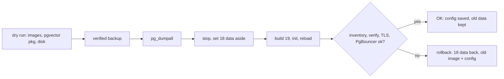

# Recipe: upgrade PostgreSQL to a new major (18 -> 19)

**Why dump/reload and not `pg_upgrade`:** the official images ship one major each. `pg_upgrade` needs the old
and the new binaries, plus PostGIS/pgvector built for both, inside one container, and the upstream images
don't provide that. A `pg_dumpall` is engine-neutral and can be verified, and at our sizes (a few GB at
most) it finishes in minutes.

**How it works:** the 18+ images keep data in `/var/lib/postgresql/<major>/docker`. The new major gets its own
directory in the **same volume**. The old directory is renamed to `.pg18-old` (the 19 entrypoint refuses to
start while `18/docker` exists) and is kept for rollback.

## Steps (on the DB server, quiet window)

1. Wait until PostGIS and pgvector ship packages for the new major (`postgresql-19-pgvector`). The dry run
   prints the package name it will use.
2. Plan: `sudo /root/docker-db-server-manager.sh pg-major-upgrade --to 19 --dry-run`. You need disk for about 2x the database size plus 512 MB.
3. Apply: `sudo /root/docker-db-server-manager.sh pg-major-upgrade --to 19` (type `UPGRADE`). It takes a verified backup first, so nothing has
   changed if that fails.
4. Look for `PG MAJOR UPGRADE OK: 18 -> 19` and `inventory matches`. Reload notices (for example, roles that
   already exist) go to `/opt/db/.pgmu-errors`.
5. Web hosts: nothing changes (same host, port, users, TLS CA). Run your app's smoke test.
6. After a week of normal running: `sudo /root/docker-db-server-manager.sh pg-major-upgrade --cleanup 18` frees the old data.

With PITR on, the tool runs `stanza-upgrade` and a new full backup. Old WAL backups belong to the old major.

## Checklist

- [ ] Extension packages exist for the new major (shown in the dry run)
- [ ] Dry run: disk OK, images as expected
- [ ] Snapshot taken (DigitalOcean) before the upgrade
- [ ] `PG MAJOR UPGRADE OK`, `doctor` clean, app smoke test passed
- [ ] `--cleanup 18` after a week

## Lessons learned

- The 18+ image entrypoint refuses to init a new major while another major's `docker` directory sits in the
  same volume. We found this in the container test, which is why the old directory is renamed rather than
  left in place.
- The size estimate must be an integer: `pg_database_size` sums as numeric, and shell arithmetic on
  `123.0` aborts a `set -e` script silently.
- On failure, the tool prints the last 30 lines of the new server's log before it rolls back. Read them:
  they say exactly why the new major would not start.
