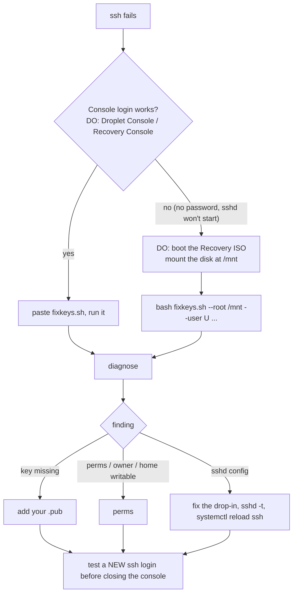

# Recover from an SSH lockout

You can't ssh in (`Permission denied (publickey)`, a changed key, a hardened config gone wrong). The way back
is the provider's **web console**, which logs in on the server's own terminal and does not use ssh.



## 1. Get a console

- **DigitalOcean:** Droplet → **Access** → *Launch Droplet Console* (works when the droplet agent runs; it
  logs you in without a password). Otherwise *Recovery Console* (needs the root password: *Reset root
  password* emails one; that reboots the droplet).
- **GCP:** VM → *Connect to serial console* (enable `serial-port-enable=TRUE`), or browser SSH (uses the
  guest agent's own key).
- Others: Vultr *View Console*, Hetzner *Console*, Linode *Lish*.

## 2. Put `fixkeys.sh` on the server

The console usually has no clipboard upload, so paste the script into a heredoc. On your computer copy
the file's contents (macOS: `pbcopy < src/shell/ssh/fixkeys.sh`). In the console:

```bash
cat > /root/fixkeys.sh << 'ENDOFSCRIPT'
# paste the whole script here, then press Enter
ENDOFSCRIPT
bash /root/fixkeys.sh --version      # prints: fixkeys 2.0.0
```

If pasting a long text is unreliable, the server may still reach GitHub:
`curl -fsSLo /root/fixkeys.sh https://raw.githubusercontent.com/simtabi/server-infra-workbench/main/src/shell/ssh/fixkeys.sh`.

## 3. Diagnose, then fix

```bash
bash /root/fixkeys.sh diagnose --user ploi        # web servers (Ploi); db servers: --user root or your sudo user
```

| Finding | Fix |
|---|---|
| no keys / wrong key | `bash /root/fixkeys.sh add --user ploi` and paste your **public** key (`cat ~/.ssh/<host>.pub` on your computer) |
| `.ssh`/file mode or owner, home group-writable | `bash /root/fixkeys.sh perms --user ploi` |
| `pubkeyauthentication no`, `AllowUsers` without you, `PermitRootLogin no` for root | edit the drop-in in `/etc/ssh/sshd_config.d/` (workbench's is `10-workbench.conf`), then `sshd -t && systemctl reload ssh` |
| `sshd -T failed` | the config has a syntax error: `sshd -t` names the file and line; fix it, then reload |
| a recent bad edit to the keys | `bash /root/fixkeys.sh restore --user ploi` and pick the backup |

Then, **without closing the console**, from your computer: `ssh -v ploi@<ip>`; look for
`Server accepts key`. Only then close the console. Finally `rm /root/fixkeys.sh`.

## 4. When the console can't log in either (recovery ISO)

DigitalOcean: power off → *Recovery* → *Boot from Recovery ISO* → power on → *Recovery Console*. Choose
*Mount your Disk Image* (it mounts at `/mnt`), then *Interactive shell*:

```bash
bash fixkeys.sh --root /mnt --user root diagnose
bash fixkeys.sh --root /mnt --user root add 'ssh-ed25519 AAAA... me@laptop'
```

`--root` reads users and owners from `/mnt/etc/passwd` (numeric ids, so ownership is right on the real
system) and writes the audit line to `/mnt/var/log/server-infra-workbench/audit.log`. `sshd -T` can't run
against a mounted disk, so it reads `/mnt/etc/ssh/sshd_config` and its drop-ins instead. Switch back to
*Boot from Hard Drive* and power-cycle.

## Prevent the next one

- `siwo server harden` refuses to turn passwords off when no `authorized_keys` entry exists and rolls
  back a drop-in that fails `sshd -t`. Keep a second session open when changing ssh.
- Remove keys with `siwo keys server remove`: it won't remove the key you are logged in with, and it
  tests a fresh login after every change.
- Keep the provider account's console access (and 2FA recovery codes) somewhere you can reach.
