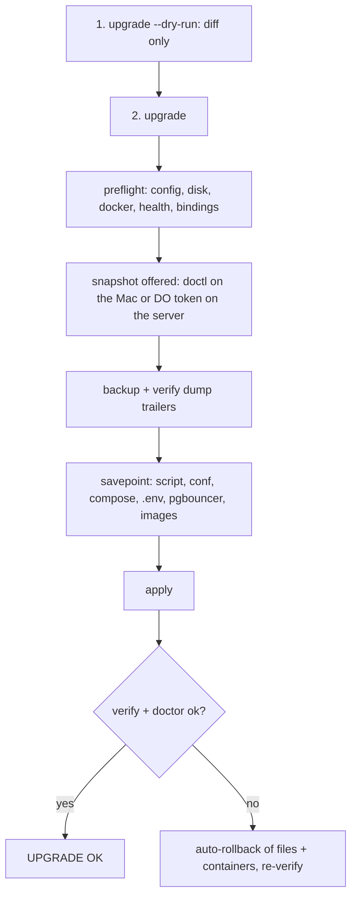

# Rollout plan: upgrading a live DB server (manager 1.3.0+)

One guided command, `upgrade`, does the whole rollout on the server: checks, backup, rollback copies,
apply, verify, and automatic rollback if anything fails. Run it **from the workstation repo folder**
through `remote-run.sh`, which refuses to run unless `--expect-ip` is on the host.

Replace `db-alias` (ssh alias or `user@public-ip`), `10.0.0.5` (private IP) and `db-server.conf` with yours.
Project examples: [`examples/`](../../examples). Full reference: [db-server.md](../tools/db-server-manager.md#upgrade).



## 0. Before you start

- Quiet window: changed containers are recreated (a few seconds of reconnects through PgBouncer).
- `make ci` green on the commit you deploy.
- Optional, for a one-command snapshot, set up doctl on the Mac (the token stays on the Mac).
  Run each line on its own: `doctl auth init` prompts for the token, and a pasted block would feed it the
  next line instead.

  ```bash
  brew install doctl
  doctl auth init        # paste a DigitalOcean token at the prompt
  doctl account get      # check it works
  ```

- Or take the snapshot yourself with the [workbench CLI](../tools/cli.md) (reads `DIGITALOCEAN_TOKEN` or the
  [credentials file](../configuration.md#platform-credentials)), then pass `--snapshot-taken` to `upgrade`:

  ```bash
  bin/workbench do droplets --tag db                                   # find the droplet id
  bin/workbench do snapshot <droplet-id> --name db-pre-upgrade --dry-run
  bin/workbench do snapshot <droplet-id> --name db-pre-upgrade --yes --wait
  ```

## 1. Dry run: what would change (writes nothing)

```bash
shell/db/remote-run.sh --host db-alias --expect-ip 10.0.0.5 --config db-server.conf -- upgrade --dry-run
```

Shows the preflight result and a unified diff of the compose file, `stack.env` and the Postgres files.

## 2. Upgrade

```bash
shell/db/remote-run.sh --host db-alias --expect-ip 10.0.0.5 --config db-server.conf -- upgrade
```

You are asked, in order (every answer is validated; Enter takes the safe default):

1. **Snapshot?** With doctl configured on the Mac, `remote-run.sh` offers it first and waits for it.
   Otherwise the server offers one if `/root/.config/digitalocean-token` (chmod 600) exists, or asks you
   to confirm that you skip it.
2. **Apply these changes?** after the diff, the verified backup and the savepoint.

Then: apply, `verify`, `doctor`. On any failure it rolls back the files and containers by itself and
re-verifies. **Data is never restored automatically**; that stays a separate, confirmed `restore`.

Unattended (cron, CI): `upgrade --yes --no-snapshot` (or `--snapshot` / `--snapshot-taken`).
`--non-interactive` without a snapshot decision stops before changing anything.

## 3. Afterwards

```bash
shell/db/remote-run.sh --host db-alias --expect-ip 10.0.0.5 --no-upload -- cron-install, doctor
shell/web/check-db-reach.sh --remote web-alias 10.0.0.5      # from the web server's side
```

## Why still a snapshot?

`upgrade` protects the stack: the verified backup covers the data, the savepoint covers files and images.
It cannot undo damage to the host itself (a full disk, a broken Docker engine or kernel, a failed apt run).
A droplet snapshot is the only undo for that, so the script recommends it and makes it one keypress.

## Optional: Adminer (loopback only)

Add `ENABLE_ADMINER=1` to `db-server.conf`, run `upgrade` again, then
`shell/tunnels/db-tunnel.sh --host db-alias adminer` and open http://127.0.0.1:8081.
Details: [connections.md](connect-to-databases.md#2-admin-web-ui-adminer-optional).

## Rollback

Automatic on failure. To go back by hand after a *successful* upgrade, the newest savepoint has everything:

```bash
ssh -t db-alias 'S=$(sudo ls -d /opt/db/upgrade-saves/* | tail -1); echo $S; cd /opt/db && sudo cp -a $S/docker-compose.yml $S/.env $S/stack.env . && sudo docker compose --env-file .env --env-file stack.env up -d --wait --remove-orphans'
shell/db/remote-run.sh --host db-alias --expect-ip 10.0.0.5 --no-upload -- verify
```

If data is damaged: `restore /opt/db/backups/<ts> all` (asks you to type RESTORE), or the droplet snapshot.
Log of every run (redacted, chmod 600): `/var/log/docker-db-server-manager.log`.
