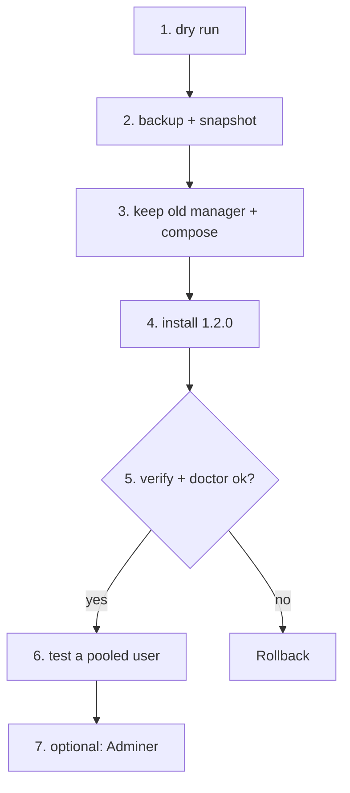

# Rollout plan: manager 1.2.0 on a live DB server

Applies the 1.2.0 changes (PgBouncer `auth_query`, user-management commands, `citext` default, optional
Adminer) to a server already running an earlier manager, without losing data. Every step runs **from the
workstation repo folder** through `remote-run.sh`, which refuses to run unless `--expect-ip` is on the host.

Replace `db-alias` (ssh alias or `user@public-ip`), `10.0.0.5` (private IP) and `db-server.conf` with yours.
Project examples: [`examples/`](../../examples).



## 0. Before you start

- Quiet window; the app keeps working, but `install` recreates PgBouncer (a few seconds of reconnects).
- Take a DigitalOcean droplet snapshot (*Droplet → Snapshots*): the outermost rollback.
- `make ci` green on the commit you deploy.

## 1. Dry run (connects to nothing)

```bash
scripts/db/remote-run.sh --dry-run --host db-alias --expect-ip 10.0.0.5 --config db-server.conf -- backup, install, verify, doctor
```

## 2. Backup with the old manager (already in /root)

```bash
scripts/db/remote-run.sh --host db-alias --expect-ip 10.0.0.5 --no-upload -- status, backup, doctor
ssh db-alias 'sudo ls -l /opt/db/backups | tail -3'
```

## 3. Keep the old manager and compose file for rollback

```bash
ssh -t db-alias 'sudo cp -a /root/docker-db-server-manager.sh /root/docker-db-server-manager.sh.pre-1.2.0 && sudo cp -a /opt/db/docker-compose.yml /opt/db/docker-compose.yml.pre-1.2.0 && sudo cp -a /opt/db/.env /root/db-env.pre-1.2.0'
```

## 4. Install 1.2.0 (keeps `.env`, passwords and volumes)

```bash
scripts/db/remote-run.sh --host db-alias --expect-ip 10.0.0.5 --config db-server.conf -- install, verify, doctor
```

`install` rewrites the compose file (PgBouncer gets `AUTH_USER`/`AUTH_DBNAME`) and recreates only changed
containers. The new `citext` default only affects fresh `template1`s; add it per database with
`--extensions citext`.

## 5. Verify

```bash
scripts/db/remote-run.sh --host db-alias --expect-ip 10.0.0.5 --no-upload -- verify, list-dbs, list-users
scripts/web/check-db-reach.sh --remote web-alias 10.0.0.5      # from the web server's side
curl -sI https://<site>/up                                     # app still healthy
```

## 6. Prove a non-bootstrap user pools through PgBouncer

```bash
scripts/db/remote-run.sh --host db-alias --expect-ip 10.0.0.5 --no-upload -- create-db rollout_probe --out /root/rollout_probe.creds
ssh -t db-alias 'sudo bash -c ". /root/rollout_probe.creds; cd /opt/db; docker compose --env-file .env --env-file stack.env exec -T -e PGPASSWORD=\$DB_PASSWORD pgbouncer psql -h 127.0.0.1 -p 5432 -U rollout_probe -d rollout_probe -tAc \"select current_user\""'
scripts/db/remote-run.sh --host db-alias --expect-ip 10.0.0.5 --no-upload -- drop-db rollout_probe --yes, drop-user rollout_probe --yes
ssh db-alias 'sudo shred -u /root/rollout_probe.creds'
```

Expected output of the second command: `rollout_probe`.

## 7. Optional: Adminer (loopback only)

Add `ENABLE_ADMINER=1` to `db-server.conf`, then:

```bash
scripts/db/remote-run.sh --host db-alias --expect-ip 10.0.0.5 --config db-server.conf -- install, doctor
scripts/local/db-tunnel.sh --host db-alias adminer       # then open http://127.0.0.1:8081
```

`doctor` must show `adminer 8081: ok (127.0.0.1:8081, tunnel only)`. Details: [connections.md](../connections.md#2-admin-web-ui-adminer-optional).

## Rollback

Data is never touched by `install`, so rollback is putting the old files back:

```bash
ssh -t db-alias 'sudo cp -a /root/docker-db-server-manager.sh.pre-1.2.0 /root/docker-db-server-manager.sh && sudo cp -a /opt/db/docker-compose.yml.pre-1.2.0 /opt/db/docker-compose.yml && cd /opt/db && sudo docker compose --env-file .env --env-file stack.env up -d --wait --remove-orphans'
scripts/db/remote-run.sh --host db-alias --expect-ip 10.0.0.5 --no-upload -- verify
```

If data is damaged (it shouldn't be): `restore /opt/db/backups/<ts> all` from step 2, or restore the droplet snapshot.
Remove the `.pre-1.2.0` copies after a week of normal running (`/root/db-env.pre-1.2.0` holds passwords: `shred -u`).
