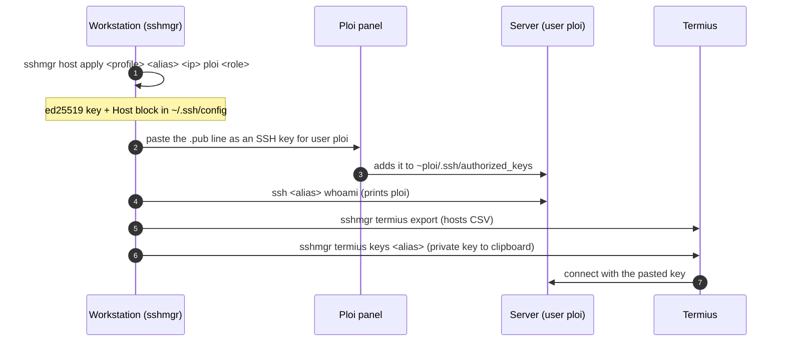
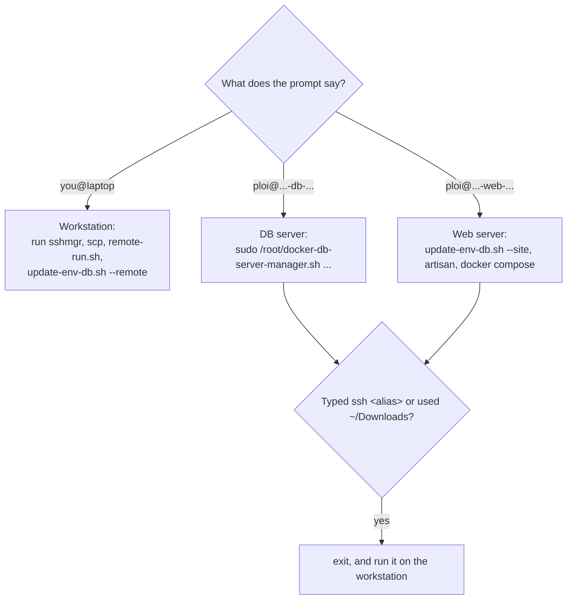

# SSH access

Keys and `~/.ssh/config` are managed with
[sshmgr](https://github.com/simtabi/ssh-manager) (sibling package). Refer to
its docs for the full command reference; this page is only the flow used here.

## Contents

- [Key flow](#key-flow)
- [1. A key per host](#1-a-key-per-host)
- [2. Authorise it on the server](#2-authorise-it-on-the-server)
- [3. sudo](#3-sudo)
- [4. Termius](#4-termius)
- [Which machine am I on?](#which-machine-am-i-on)

## Key flow



## 1. A key per host

```sh
sshmgr host apply <profile> <alias> <public-ip> ploi <role> --reconcile
# web: sshmgr host apply myproj prd-web-00 203.0.113.10 ploi web --reconcile
# db:  sshmgr host apply myproj prd-db-00  203.0.113.20 ploi db  --reconcile
```

This mints an ed25519 key for the host and writes the `Host <alias>` block.
When a server's IP changes, run the same command with the new IP.

## 2. Authorise it on the server

Add the host's **public** key (`.pub`, the line starting `ssh-ed25519`) to the
server's SSH keys in Ploi, for the **`ploi`** user. Then test:

```sh
ssh <alias> whoami                             # -> ploi
ssh -G <alias> | grep -E '^(hostname|user) '   # where the alias points
```

`Permission denied (publickey)` means the key is not on the server (yet).
Root login with your key is normally refused; use `ploi` + `sudo`.

## 3. sudo

The `ploi` user's sudo password is shown once by Ploi and sent in the
"server provisioned" email. It is not the database or Ploi-login password. If
it is lost, open the droplet's web console in DigitalOcean (root, no key) and
run `passwd ploi`. Test with `ssh -t <alias> 'sudo -k; sudo whoami'`.

## 4. Termius

Termius's CSV import cannot carry keys, so imported hosts stop at key
selection. Export the hosts, then add each key by hand:

```sh
sshmgr termius export                           # hosts CSV for Termius import
sshmgr termius keys                             # list hosts, key labels, key paths
sshmgr termius keys <alias> --clear-after 60s   # private key -> clipboard
```

In Termius: **Keychain > New Key**, set **Label** to the printed label, paste
into **Private key**, Save, then pick the key on the host and
**Continue & Save**. "Authentication failed (publickey)" in Termius with the
right key selected means the same as above: the public key is not on the
server for that user. After an IP change, re-export or edit the host address.

## Which machine am I on?



If the prompt says `ploi@<server>`, you are **on** the server. Commands meant
for your workstation (`scp ~/Downloads/...`, `ssh <alias> ...`) fail there:
the file does not exist, the alias does not resolve (`Could not resolve
hostname`), or the server tries to SSH into itself (`Permission denied`).
Exit, and run them locally. `remote-run.sh` refuses to run on a Ploi server for
the same reason.
