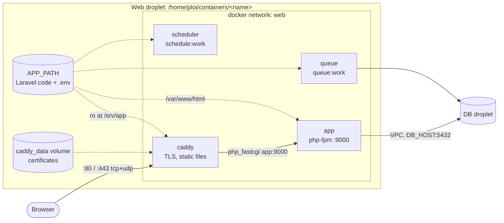

# Web server with Caddy (Ploi Docker server)

How to run a Laravel app behind [Caddy](https://caddyserver.com) on a Ploi
**Docker** server, using the files in [`stacks/caddy/`](../../stacks/caddy).
Caddy terminates TLS and gets and renews Let's Encrypt certificates by itself.
For a native Ploi site (nginx + PHP-FPM, no Docker) use
[web-server-ploi.md](../recipes/configure-a-ploi-web-server.md) instead.

## Contents

- [How it fits together](#how-it-fits-together)
- [Files](#files)
- [1. DNS and firewall](#1-dns-and-firewall)
- [2. Put the files on the server](#2-put-the-files-on-the-server)
- [3. Configure](#3-configure)
- [4. Validate and start](#4-validate-and-start)
- [5. Check it works](#5-check-it-works)
- [Day-2: reload, logs, upgrades](#day-2-reload-logs-upgrades)
- [Staging and production](#staging-and-production)
- [Variants](#variants)
- [Troubleshooting](#troubleshooting)
- [Sources](#sources)

## How it fits together



| Service | Image | Port | Notes |
|---|---|---|---|
| `caddy` | `caddy:2.11` (`CADDY_IMAGE`) | 80, 443, 443/udp on the host | the only published ports |
| `app` | built from `php/Dockerfile` (`APP_IMAGE`) | 9000 inside the network | php-fpm |
| `queue` | same as `app` | none | replaces the Ploi queue daemon |
| `scheduler` | same as `app` | none | replaces the Ploi scheduler daemon; don't add a `schedule:run` cron as well |
| `whoami` | `traefik/whoami` | 80 inside the network | only with `--profile smoke` |

## Files

| File | Purpose |
|---|---|
| `docker-compose.yml` | the stack above, one network (`web`), volumes `caddy_data` + `caddy_config` |
| `conf/Caddyfile` | active config: Laravel via `php_fastcgi` |
| `variants/reverse-proxy.Caddyfile` | for an app that serves HTTP itself (Octane, FrankenPHP, Node) |
| `variants/smoke-test.Caddyfile` | proves DNS + HTTPS with `whoami` before the app exists |
| `php/Dockerfile` | php-fpm 8.5 with `pdo_pgsql`, `pdo_mysql`, `intl`, `zip`, `bcmath`, `opcache`, `pcntl` |
| `.env.example` | copy to `.env` (never committed) |

`conf/` is mounted as the whole `/etc/caddy` folder rather than the single
Caddyfile. The Caddy image docs recommend this: editors replace files when
saving, and a single-file bind mount would keep showing the old file to the
container.

Two copies of the code path matter: php-fpm sees the app at `/var/www/html`
and Caddy sees it read-only at `/srv/app`. That is why the Caddyfile has
`root * /srv/app/public` (for static files) and `root /var/www/html/public`
inside `php_fastcgi` (for the script path sent to php-fpm). Caddy mounts the
whole app, not only `public/`, so the `public/storage` symlink from
`php artisan storage:link` resolves.

## 1. DNS and firewall

1. Create an **A** record (and **AAAA** if the droplet has IPv6) for each
   domain, e.g. `app.example.com` and `staging.example.com`, pointing at the
   web droplet's **public** IP. Check: `dig +short app.example.com`.
2. Ports **80** and **443** (tcp, plus 443/udp for HTTP/3) must reach the
   droplet. Caddy needs 80 for the ACME HTTP challenge and redirects. If ufw
   is on: `sudo ufw allow 80/tcp && sudo ufw allow 443` (Ploi servers usually
   have these open already; check with `sudo ufw status`). Docker-published
   ports bypass ufw rules, so also check any DigitalOcean Cloud Firewall.
3. Nothing else may listen on 80/443:
   `sudo ss -ltnp '( sport = :80 or sport = :443 )'`. If nginx or a Ploi
   proxy already holds them, use that instead of Caddy, or free the ports first.

## 2. Put the files on the server

Pick one:

- **Ploi panel.** Create a Docker application/container on the server and
  paste `docker-compose.yml`. Ploi keeps it in `/home/ploi/containers/<name>`
  and runs `docker compose up` / `down` for you. You still need to add
  `conf/`, `php/`, `.env` and the app code to that folder (scp, below).
  (Ploi's API equivalent is `POST /api/servers/{server}/docker/containers`.)
- **Plain folder over SSH.** From your workstation:

  ```sh
  ssh <web-alias> mkdir -p /home/ploi/containers/myapp
  scp -r stacks/caddy/{docker-compose.yml,conf,variants,php,.env.example} \
      <web-alias>:/home/ploi/containers/myapp/
  ```

Then the app code: clone it into `APP_PATH` (default `./app` inside that
folder) and create its `.env` with the database values from
[update-env-db.sh](../recipes/configure-a-ploi-web-server.md#update-db_-settings) (`--env
/home/ploi/containers/myapp/app/.env`).

```sh
ssh <web-alias>
cd /home/ploi/containers/myapp
git clone git@github.com:you/app.git app      # needs a deploy key on the server
cp .env.example .env && nano .env              # SITE_DOMAIN etc.
```

## 3. Configure

`.env` (next to `docker-compose.yml`):

| Key | Default | Meaning |
|---|---|---|
| `COMPOSE_PROJECT_NAME` | `web` | compose project; use different names for staging and prod on one host |
| `SITE_DOMAIN` | *(required)* | domain(s) Caddy serves; comma-separated list allowed |
| `APP_PATH` | `./app` | Laravel checkout (contains `public/` and `.env`) |
| `APP_IMAGE` | `local/laravel-fpm:8.5` | tag for the built php-fpm image |
| `CADDY_IMAGE` | `caddy:2.11` | pin a minor version; bump deliberately |
| `PROXY_NETWORK` | `web` | docker network name; other projects can join it as `external: true` |
| `ACME_CA` | Let's Encrypt production | set to the staging URL while testing to avoid rate limits |
| `UPSTREAM` | `app:8000` | used only by `variants/reverse-proxy.Caddyfile` |

`conf/Caddyfile`:

```caddyfile
{
	acme_ca {$ACME_CA:https://acme-v02.api.letsencrypt.org/directory}
}

{$SITE_DOMAIN} {
	root * /srv/app/public
	encode zstd gzip
	php_fastcgi app:9000 {
		root /var/www/html/public
	}
	file_server
	log
}
```

In the app's `.env`, `DB_HOST` is the DB droplet's **VPC** IP; containers reach
the VPC through the host, no extra network setup needed. Set
`APP_URL=https://<domain>`. Laravel must trust the proxy headers for HTTPS URLs;
with php-fpm behind Caddy, `$_SERVER['HTTPS']` is set by `php_fastcgi`, so it
usually works without `TrustProxies` changes.

## 4. Validate and start

```sh
docker compose config -q                    # compose file + .env are valid
docker compose run --rm --no-deps caddy caddy validate --config /etc/caddy/Caddyfile
docker compose build app
docker compose up -d
docker compose exec app php artisan migrate --force
docker compose exec app php artisan storage:link
docker compose exec app php artisan optimize
```

The repo checks both on every `make ci` (`make compose-check`).

## 5. Check it works

```sh
curl -I http://app.example.com          # 308 redirect to https
curl -I https://app.example.com         # 200 (or 302 to /login), "server: Caddy"
docker compose ps                       # all services "running"
docker compose logs -f caddy            # look for "certificate obtained successfully"
docker compose logs --tail=50 app queue scheduler
```

## Day-2: reload, logs, upgrades

| Task | Command |
|---|---|
| Reload after editing `conf/Caddyfile` (no downtime) | `docker compose exec -w /etc/caddy caddy caddy reload` |
| Format the Caddyfile | `docker compose exec -w /etc/caddy caddy caddy fmt --overwrite` (needs `conf` mounted rw) |
| Deploy new code | `git -C app pull && docker compose exec app composer install --no-dev -o && docker compose exec app php artisan migrate --force && docker compose exec app php artisan optimize && docker compose restart queue` |
| Upgrade Caddy | bump `CADDY_IMAGE`, `docker compose pull caddy && docker compose up -d caddy` |
| Rebuild PHP | `docker compose build --pull app && docker compose up -d` |
| Logs | `docker compose logs -f caddy app` |

Never delete the `caddy_data` volume (`docker compose down -v`): it holds the
certificates and account keys, and re-issuing too often hits Let's Encrypt rate limits.

## Staging and production

Use the same files twice, in two folders with their own `.env`:

| | Staging | Production |
|---|---|---|
| Folder | `/home/ploi/containers/staging` | `/home/ploi/containers/app` |
| `COMPOSE_PROJECT_NAME` | `staging` | `app` |
| `SITE_DOMAIN` | `staging.example.com` | `app.example.com` |
| `ACME_CA` | staging URL while testing, then production | production |
| App `.env` | `APP_ENV=staging`, staging database | `APP_ENV=production` |

Only one Caddy can own ports 80/443 on a host. If staging and production
share a droplet, run Caddy once and list both domains, each with its own
site block and upstream (`php_fastcgi staging-app-1:9000 ...`), with both
projects on the shared `web` network (`external: true` in the second project).
Separate droplets are simpler.

## Variants

- **Reverse proxy** (app serves HTTP on a port):
  `cp variants/reverse-proxy.Caddyfile conf/Caddyfile`, set `UPSTREAM`, reload.
- **Smoke test** before the app exists:

  ```sh
  cp variants/smoke-test.Caddyfile conf/Caddyfile
  docker compose --profile smoke up -d --no-deps caddy whoami
  curl https://<domain>        # whoami echoes the request
  ```

  Then copy the Laravel Caddyfile back (`git checkout conf/Caddyfile` or from
  the repo) and `docker compose up -d`.

## Troubleshooting

| Symptom | Cause / fix |
|---|---|
| Caddy log: `challenge failed`, `timeout during connect` | DNS not pointing here yet, or port 80 blocked. Check `dig`, ufw, DO firewall |
| `bind: address already in use` on 80/443 | nginx or another proxy is running; see step 1.3 |
| 502 / `dial tcp: lookup app` | `app` container not running or not on the `web` network: `docker compose ps` |
| `File not found.` from php-fpm | the `root` inside `php_fastcgi` doesn't match where php-fpm sees the code (`/var/www/html/public`) |
| CSS/JS 404 but PHP pages work | Caddy can't see the files: check `APP_PATH` and `root * /srv/app/public` |
| Edits to the Caddyfile ignored | reload with `caddy reload` (above); mount the `conf/` folder, not the file |
| Browser warns about the certificate | `ACME_CA` still points at staging |
| `SQLSTATE[08006]` connection timeout | DB firewall/VPC: test `docker compose exec app php -r 'var_dump(@fsockopen("<db-ip>",5432));'` |

## Sources

- Caddy: [`php_fastcgi`](https://caddyserver.com/docs/caddyfile/directives/php_fastcgi),
  [automatic HTTPS](https://caddyserver.com/docs/automatic-https),
  [`reverse_proxy`](https://caddyserver.com/docs/caddyfile/directives/reverse_proxy),
  [command line (`reload`, `validate`)](https://caddyserver.com/docs/command-line),
  [Docker image](https://hub.docker.com/_/caddy).
- Ploi: [Docker server](https://ploi.io/documentation/docker/how-to-install-a-docker-server),
  [create container API](https://developers.ploi.io/containers/create-container).
