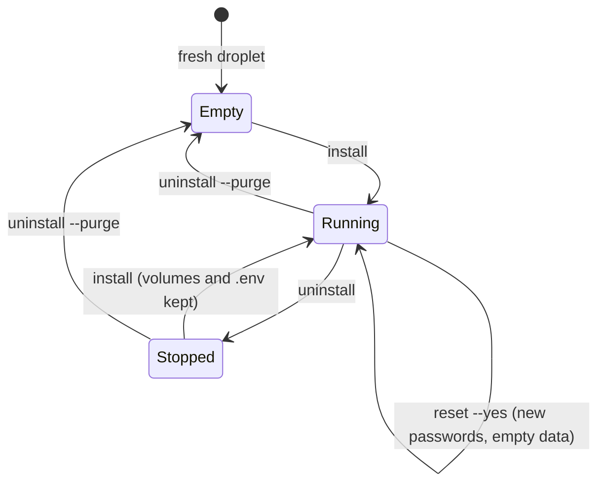
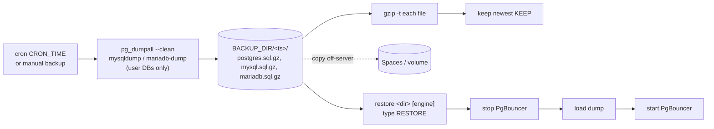

# DB server: Docker DB Server Setup Manager

[`src/shell/db/docker-db-server-manager.sh`](../../src/shell/db/docker-db-server-manager.sh) builds and runs a dedicated database droplet (DigitalOcean, Ubuntu) for a Laravel app. It installs, resets, checks, backs up and restores the stack, and it can uninstall it. Every name, port, image and path below is a default you can change (see [Configuration](#5-configuration)); `<user>`/`<db>` mean `PG_USER`/`PG_DB`.

## Contents

0. [Runbook](#0-runbook-from-your-workstation) ·
1. [Overview](#1-overview) ·
2. [Requirements](#2-requirements) ·
3. [Quick start](#3-quick-start) ·
4. [Commands](#4-commands) ·
5. [Configuration](#5-configuration) ·
6. [Extensions](#6-postgresql-extensions) ·
7. [Connecting Laravel](#7-connecting-from-the-web-server-laravel) ·
8. [PgBouncer](#8-pgbouncer-notes) ·
9. [Security](#9-security) ·
10. [Upgrades](#10-upgrades) ·
11. [Troubleshooting](#11-troubleshooting) ·
12. [Uninstall](#12-uninstall)

Moving an existing server to this version: [upgrading.md](../recipes/upgrade-a-legacy-db-server.md).

## 0. Runbook (from your workstation)

> Run these on your **laptop**. If your prompt says `ploi@<db-host>`, you are on the
> server: `~/Downloads` does not exist there, and `ssh <alias>` connects the server to
> itself and fails with `Permission denied (publickey)`.

1. Find the private IP once (on the server): `ip -4 -o addr show eth1`. `eth0` has the
   public IP **and** a `10.10.x.x` anchor IP; that one is normal and is not the VPC IP.
2. Check the alias points where you think: `ssh -G <db-alias> | grep -E '^(hostname|user) '`.
3. Test sudo on its own first: `ssh -t <db-alias> 'sudo -k; sudo whoami'` should print `root`.
   The `ploi` sudo password is in Ploi's "server provisioned" email (not the DB or Ploi-login
   password; type it if copy-paste adds whitespace). Lost it? Open the droplet's **web console**
   in DigitalOcean (logs in as root without a key) and run `passwd ploi`.
4. If the login banner says `*** System restart required ***`, run `sudo reboot` and reconnect.
5. Run the manager with the wrong-server guard:

```sh
src/shell/db/remote-run.sh --host <db-alias> --expect-ip <private-ip> \
  --config my-db-server.conf -- reset --yes, verify, cron-install, env
```

That uploads the script (scp to `~`), installs it to `/root` with `sudo install -m 755`, aborts
with `ABORT: this is <host>, not the db server` unless `<private-ip>` is on the host, then runs
each command with sudo (one password prompt). Use `install` instead of `reset --yes` to keep
existing data. For `upgrade` it first offers a droplet snapshot from your Mac: doctl if configured,
otherwise `bin/workbench do snapshot` (token from the credentials file), otherwise the server's own token,
otherwise you type `CONTINUE` on the server; `--snapshot-with doctl|workbench|server|none` forces one.
The equivalent by hand:

```sh
scp src/shell/db/docker-db-server-manager.sh <db-alias>:~/
ssh -t <db-alias> 'ip -4 addr | grep -q "inet <private-ip>/" || { echo "ABORT: $(hostname)"; exit 1; }
  sudo install -m 755 ~/docker-db-server-manager.sh /root/docker-db-server-manager.sh &&
  sudo /root/docker-db-server-manager.sh reset --yes && sudo /root/docker-db-server-manager.sh cron-install &&
  sudo /root/docker-db-server-manager.sh env'
```

6. Put the printed `DB_*` lines on the web server: [web-server-ploi.md](../recipes/configure-a-ploi-web-server.md#update-db_-settings).

## 1. Overview

| Service | Image | Port (private IP only) | Login |
|---|---|---|---|
| PostgreSQL 18.6 + PostGIS 3.6 + pgvector 0.8 | `PG_IMAGE` (default `local/postgres:18-postgis-pgvector`, built from `postgis/postgis:18-3.6`) | `5432` | `<user>` / `PG_PASSWORD` (superuser, so it can create databases) |
| PgBouncer 1.26.1, session mode, scram-sha-256 | `edoburu/pgbouncer:v1.26.1-p0` | `6432` → container `5432` | same as Postgres |
| MySQL 9.7 | `mysql:9.7` | `3306` | `root` / `MYSQL_ROOT_PASSWORD` |
| MariaDB 13 | `mariadb:13` | `3307` → container `3306` | `root` / `MARIADB_ROOT_PASSWORD` |

```
 web server (VPC IP) ──── VPC_CIDR ────▶ db server PRIVATE_IP (eth1)
                                                    ├─ :5432 postgres ◀─┐
                                                    ├─ :6432 pgbouncer ─┘
                                                    ├─ :3306 mysql
                                                    └─ :3307 mariadb
```

Every port is bound to the private IP, so none of them is reachable from the public internet. That matters because Docker-published ports can bypass ufw. As a second layer, ufw allows only the VPC range.

### Files (`/opt/db`)
```
/opt/db/.env                         PRIVATE_IP + 3 generated passwords (chmod 600)
/opt/db/stack.env                    non-secret settings (users, images, ports)
/opt/db/docker-compose.yml
/opt/db/postgres/Dockerfile
/opt/db/postgres/init/10-extensions.sql
/opt/db/backups/<YYYYmmdd-HHMMSS>/{postgres,mysql,mariadb}.sql.gz
Docker volumes: db_pg_data, db_mysql_data, db_mariadb_data
```
Every run of `install` and `reset` rewrites these files from the script, so make changes in the script rather than in the files.

## 2. Requirements
- Ubuntu or Debian on amd64 (the PostGIS image is amd64-only), run as root (`sudo`).
- Outbound access to Docker Hub, `apt.postgresql.org` (HTTPS) and `deb.debian.org`.
- A private network interface (`eth1`). Docker and the compose plugin are installed automatically if they're missing.

## 3. Quick start
See the [runbook](#0-runbook-from-your-workstation) above. On the server itself:
```sh
sudo /root/docker-db-server-manager.sh install      # first time (keeps existing .env/data)
sudo /root/docker-db-server-manager.sh cron-install # daily backups
sudo /root/docker-db-server-manager.sh env          # lines for the web server .env
```
To wipe everything and start over, run `sudo ... reset`. You'll be asked to type `RESET`.

## 4. Commands

| Command | Changes data? | Prompts | What it does |
|---|---|---|---|
| `init [file]` | no (writes a config file) | no | starter config for this host: detects the private IP and VPC range; no root needed |
| `upgrade [--dry-run] [--snapshot\|--snapshot-taken\|--no-snapshot]` (alias `apply`) | no (backs up first) | snapshot, apply (or `--yes`) | guided upgrade of a running server: preflight, diff, snapshot offer, verified backup, savepoint, apply, verify + doctor, auto-rollback; see [Upgrade](#upgrade) |
| `install` | no (keeps `.env` and volumes) | no | Docker, files, build, `up --wait`, ufw, `verify`, summary |
| `reset` | **destroys** all DB data | `Type RESET` (or `--yes`) | new passwords, rebuild from scratch |
| `status` | no | no | `docker compose ps` |
| `verify` | no | no | health, extensions, logins for each enabled engine |
| `doctor` | no | no | host checks: ports only on the private IP, ufw default deny, unattended-upgrades, reboot-required, free disk, age of the newest backup, cron |
| `env [engine]` | no | no | prints the `DB_*` lines (contains the password) |
| `create-db <name> [engine] [--extensions a,b] [--readonly-user] [--out F]` | creates a database + owner user | no | random password, PgBouncer-ready, prints the `DB_*` lines once |
| `create-user <u> <db> [engine] [--readonly] [--out F]` | creates a user | no | read-write (default) or read-only on one database |
| `grant <u> <db> [engine] [--readonly\|--readwrite]` | changes grants | no | adds access to another database |
| `rotate-password <u> [engine] [--out F]` | changes a password | no | new random password, printed once |
| `list-dbs [engine\|all]` / `list-users [engine\|all]` | no | no | databases with owner and size; login users and the DBs they can reach |
| `drop-db <name> [engine]` / `drop-user <u> [engine]` | **deletes** | `Type DROP` (or `--yes`) | protected: `PG_USER`, `PG_DB`, `root`, system databases |
| `backup` | writes `BACKUP_DIR/<ts>/` | no | one gzip dump per enabled engine plus MySQL/MariaDB users and grants, prunes to `KEEP`, then `BACKUP_HOOK` |
| `restore <dir> [postgres\|mysql\|mariadb\|all]` | **overwrites** | `Type RESTORE` (or `--yes`) | loads the dumps |
| `cron-install` / `cron-remove` | cron file only | no | daily `backup` at `CRON_TIME` |
| `logs [service]` | no | no | follow the last 200 lines |
| `uninstall [--purge]` | `--purge` deletes everything | `Type PURGE` | stop and remove |
| `help` | no | no | detailed help |

Options (anywhere on the line): `--yes`/`-y` (or `FORCE=1`), `--non-interactive` (never prompt; fail safe), `--config FILE`
(or `DBM_CONFIG`), `--version`.



### `install`
This installs or enables Docker, keeps an existing `.env` (or creates one with new passwords), writes the files, builds the image, waits until all services are healthy, adds the firewall rules, runs `verify` and prints the summary. It does not delete any data, so it's safe to run again.

### `reset` (destroys data)
```sh
./docker-db-server-manager.sh reset           # prompts: Type RESET
./docker-db-server-manager.sh reset --yes     # or FORCE=1
```
In order, it:
1. Runs `docker compose down -v --remove-orphans`.
2. Removes the `db_*` volumes and the built image.
3. Copies the old `.env` to `/root/db-env-backup-<ts>` (chmod 600).
4. Deletes the generated files and writes a new `.env` with **new passwords**.
5. Builds with `--pull --no-cache` and runs `up -d --wait`.
6. Adds the firewall rules, runs `verify` and prints the summary.

Backups in `/opt/db/backups` are kept. After a reset, update `DB_PASSWORD` on the web server.

Expected ending:
```
-- pgbouncer (via docker network pgbouncer:5432, scram; host port 10.0.0.5:6432):
pgbouncer ok: PostgreSQL 18.6 (Debian 18.6-1.pgdg13+2) on x86_64-pc-linux-gnu ...
-- mysql:
mysqld is alive
9.7.4
-- mariadb:
mariadb healthcheck ok
mysqld is alive
13.0.2-MariaDB-ubu2604
ALL CHECKS PASSED
...
DB_CONNECTION=pgsql
DB_HOST=10.0.0.5
DB_PORT=5432
DB_DATABASE=app
DB_USERNAME=app
DB_PASSWORD=<48 hex chars>
```

### `status`
Runs `docker compose ps`. All four services should show `Up (healthy)`.

### `verify`
Runs these checks:
- `pg_isready` against Postgres
- the extension list for `<db>` and for `template1`
- a password login through PgBouncer, reached over the Docker network (`host=pgbouncer port=5432`). It deliberately does **not** use `PRIVATE_IP:6432`: from inside a container that is hairpin traffic to the host's own private IP, which ufw drops (the source is a Docker bridge address, not in `VPC_CIDR`), so the check timed out although the web server could connect fine
- a direct password login over TCP at `127.0.0.1:5432` inside the Postgres container
- `mysqladmin ping` plus the MySQL version
- MariaDB `healthcheck.sh` and `mariadb-admin ping` plus the version

It ends with `ALL CHECKS PASSED`, and any failure stops it with a line like `!! ERROR: line N`.

### `env`
Prints the `DB_*` lines for `WEB_ENV` (the shared Laravel `.env`; see [web-server-ploi.md](../recipes/configure-a-ploi-web-server.md)). This output **contains the Postgres password**.

### `init`
```sh
ssh <db-alias> 'bash -s -- init' < src/shell/db/docker-db-server-manager.sh > my-db-server.conf
```
Prints a config for the host it runs on (`EXPECTED_PRIVATE_IP`, `PRIVATE_IP` and
`VPC_CIDR` from `PRIVATE_IFACE`, engines, users). It contains no secrets. Edit it,
then install it with `remote-run.sh --config` or `sudo install -m 600 FILE /etc/docker-db-server-manager.conf`.

### Engines
Each engine can be switched off in the config: `ENABLE_POSTGRES`, `ENABLE_PGBOUNCER`,
`ENABLE_MYSQL`, `ENABLE_MARIADB` (`1`/`0`, all `1` by default). A disabled engine gets
no container, published port, firewall rule, backup or check. PgBouncer needs
Postgres. Turning an engine off later and running `install` removes its container
(`--remove-orphans`) but keeps its volume until `uninstall --purge`.

### `create-db <name> [engine]`
Creates database `<name>` owned by a new user `<name>` with a random password, on one engine
(default: the first enabled of postgres, mysql, mariadb). Names: `a-z 0-9 _`, max 63 (Postgres) or 32
(MySQL/MariaDB). An existing user is refused, so re-running is safe.

- **Isolation:** `PUBLIC` loses `CONNECT` on the new database and on `PG_DB`, so app users can't open each
  other's databases. MySQL/MariaDB users get `ALL` on their own schema only.
- **PgBouncer:** PgBouncer looks up any login role through `PG_USER` (`auth_user` + its default
  `auth_query`), so new Postgres users work on `PGBOUNCER_PORT` at once; the manager also sends `RELOAD`.
  The printed `DB_PORT` is the PgBouncer port.
- **Extensions:** every new Postgres database copies `template1`, which `install` filled with
  `PG_EXTENSIONS` (default `vector postgis pg_trgm pgcrypto uuid-ossp citext pg_stat_statements`).
  `--extensions citext,hstore` adds more to just this database (comma-separated; must exist in the image:
  contrib modules, PostGIS, pgvector). JSONB is built in and needs nothing. Servers installed before
  `citext` was in the default get it with `--extensions citext`.
- **Read-only user:** `--readonly-user` also creates `<name>_ro` with `SELECT` on current and future tables.
- **Secrets:** SQL goes to the client on stdin (passwords never appear in `ps`). Credentials print once,
  or go to a new chmod 600 file with `--out FILE` (copy them into the app's `.env`, then `shred -u FILE`).

```bash
sudo /root/docker-db-server-manager.sh create-db shop --extensions citext,hstore --readonly-user --out /root/shop.creds
sudo /root/docker-db-server-manager.sh create-user shop_report shop --readonly
sudo /root/docker-db-server-manager.sh grant shop_report blog mysql --readonly
sudo /root/docker-db-server-manager.sh rotate-password shop
sudo /root/docker-db-server-manager.sh list-users all
sudo /root/docker-db-server-manager.sh drop-user shop_report      # type DROP
```

`rotate-password` refuses `PG_USER` (its password is shared with PgBouncer's config); rotate that with
`reset` on a new server, or by hand: `ALTER ROLE`, update `PG_PASSWORD` in `/opt/db/.env`, `install`.
`drop-user` on Postgres reassigns the user's objects to `PG_USER` in every database, then drops the role.

### `doctor`
Read-only health check of the host (run as root for the ufw part). Every line is
`ok`, `WARN` or `FAIL`; exit code 1 on any `FAIL`.

### `backup`


```sh
./docker-db-server-manager.sh backup
KEEP=14 BACKUP_DIR=/mnt/volume/db ./docker-db-server-manager.sh backup
```
It writes three gzip dumps to `$BACKUP_DIR/<ts>/` (chmod 600) and runs `gzip -t` on each one. It keeps the newest `$KEEP` backups (default 7) and prunes the rest.
- Writes to `BACKUP_DIR/.partial-<ts>` and renames it to `<ts>` only when every
  dump succeeded, so a half-written backup is never counted or restored. Refuses to
  start with less than `MIN_FREE_MB` free. `BACKUP_DIR` is `chmod 700`.
- MySQL and MariaDB users and grants go to `grants-<engine>.sql.gz` (dumps of the
  `mysql` system schema are not portable between versions).
- `BACKUP_HOOK` (optional) runs after a good backup with the directory as `$1`, for
  an offsite copy (rclone, `aws s3`, `restic`...). A hook failure fails the backup run.
- `cron-install` also writes `/etc/logrotate.d/docker-db-server-backup` (weekly, 8 kept).
- Nightly dumps mean up to 24 h of data loss, and backups aren't restore-tested
  automatically; see [point-in-time recovery](../status.md#point-in-time-recovery) and
  [restore test](../status.md#restore-test).
- **Postgres** uses `pg_dumpall --clean --if-exists`, which covers every database (including ones the app creates itself) and every role.
- **MySQL and MariaDB** dump only user databases. The `mysql`, `sys` and `*_schema` system schemas are left out on purpose, so a restore never overwrites root or the passwords in `.env`. Database users you create yourself in MySQL or MariaDB are therefore **not** backed up, so recreate them after a restore.

When you run it with `sudo`, put the variables after sudo: `sudo KEEP=14 ./docker-db-server-manager.sh backup`.

### `restore <dir> [postgres|mysql|mariadb|all]` (overwrites data)
```sh
./docker-db-server-manager.sh restore /opt/db/backups/20261025-031500
./docker-db-server-manager.sh restore /opt/db/backups/20261025-031500 postgres --yes
```
You'll be asked to type `RESTORE`. During a Postgres restore, PgBouncer is stopped so it releases its pooled connections, and the `<user>` role statements are skipped (you are connected as that role). You can ignore notices like `database "<db>" already exists`. MySQL/MariaDB dumps contain user databases only, so a restore cannot bring back old root users or passwords.

### `cron-install` / `cron-remove`
Writes `/etc/cron.d/docker-db-server-backup`, which runs `backup` at `CRON_TIME` (default `15 3 * * *`, 03:15 **server time**, which is UTC on DO droplets) and logs to `/var/log/docker-db-server-backup.log`. The job runs the script from where it is when you install the cron, so keep it there (for example `/root/docker-db-server-manager.sh`).

### `logs [service]`
`./docker-db-server-manager.sh logs pgbouncer` shows the last 200 lines and keeps following the log.

### `uninstall [--purge]`
- Without `--purge`, it stops and removes the containers and keeps the volumes and `/opt/db`. Run `install` to bring everything back.
- With `--purge` (type `PURGE`), it also removes the volumes, the image, the cron job and all of `/opt/db`, **backups included**.

The ufw rules are left in place. Remove them with `ufw status numbered` and `ufw delete N`.

### `help`
Prints the detailed help with examples.

## 5. Configuration
| Variable | Default | Meaning |
|---|---|---|
| `PRIVATE_IP` | the value in `.env`, else the IPv4 address on `PRIVATE_IFACE` (`eth1`); required otherwise | the address all ports bind to |
| `EXPECTED_PRIVATE_IP` | unset | abort unless this IP is on the host |
| `VPC_CIDR` | `10.0.0.0/8` (set your VPC range, e.g. `10.0.0.0/20`; `init` prints it) | source range for the ufw rules |
| `DB_DIR` | `/opt/db` | install folder |
| `BACKUP_DIR` | `$DB_DIR/backups` | where backups go |
| `KEEP` | `7` | backups kept after each `backup` |
| `FORCE=1` / `--yes` / `-y` | off | skip the typed confirmation (required when there's no terminal) |

Also configurable: `PG_USER`/`PG_DB` (`app`), `PG_IMAGE`, `PG_BASE_IMAGE`, `PGVECTOR_PKG`, `PG_MAX_CONNECTIONS` (200), `PGBOUNCER_IMAGE`, `PGBOUNCER_MAX_CLIENT_CONN` (500), `PGBOUNCER_POOL_SIZE` (20), `MYSQL_IMAGE`, `MARIADB_IMAGE`, the four `*_PORT`s, `CRON_TIME`, `CRON_FILE`, `CRON_LOG`, `WEB_ENV`. Put them in `/etc/docker-db-server-manager.conf` (template: [`config/db-server.env.example`](../../config/db-server.env.example)), or pass `--config FILE`. Environment variables beat the file. `shared_preload_libraries=pg_stat_statements` is fixed.

## 6. PostgreSQL extensions
These are created in `<db>` **and in `template1`**, so every database created later gets them automatically:

`vector` 0.8.7, `postgis` 3.6.4, `pg_trgm` 1.6, `pgcrypto` 1.4, `uuid-ossp` 1.1, `pg_stat_statements` 1.12 (plus `plpgsql`).

The init SQL only runs when the data volume is brand new. To get these into an existing database, either run `reset` or run `CREATE EXTENSION ...` by hand. Other extensions that ship in the image but aren't enabled, such as `postgis_topology`, `fuzzystrmatch`, `hstore` and `citext`, can be added with `CREATE EXTENSION`.

## 7. Connecting from the web server (Laravel)
```sh
# on the db server
sudo /root/docker-db-server-manager.sh env > ~/db.env   # contains the password
# on your workstation (see web-server-ploi.md)
src/shell/web/update-env-db.sh --remote <web-alias> --site <domain> --from db.env
# on the web server
nc -zv <PRIVATE_IP> 5432      # should say "succeeded"
```
Then **redeploy in Ploi**, because the config is cached at deploy time. For MySQL or MariaDB, use `DB_CONNECTION=mysql` or `mariadb` with port 3306 or 3307. Rather than using root, create a dedicated user for the app.

## 8. PgBouncer notes
- It runs in session mode, so Laravel and prepared statements work unchanged. To use it, set `DB_PORT=6432`.
- It **must** stay in session mode for Laravel. **Creating or dropping databases** (e.g. a multi-database app provisioning one) needs a direct Postgres connection on 5432 and a role with `CREATEDB` (the bootstrap user is a superuser). Keep the app on 5432 until you've tested it on 6432.
- The edoburu image writes `"<user>" "<plain password>"` to `userlist.txt`, which scram-sha-256 needs so it can log in to Postgres on the client's behalf.
- You can query the admin console with `psql "host=<PRIVATE_IP> port=6432 user=<user> dbname=pgbouncer" -c "show pools;"`. Its healthcheck logs a login every 5 seconds; that is expected, not an attack.
- Transaction mode would need extra Laravel settings (emulated prepares) and isn't configured.

## 9. Security

Firewall, Docker vs ufw, updates and secrets on disk: [security.md](../security.md). Web-to-DB
traffic is unencrypted on the VPC ([roadmap](../status.md#private-network-encryption)).
- Ports are bound to the private IP only, and ufw allows only `VPC_CIDR` on 5432, 6432, 3306 and 3307. Existing ufw rules are detected, so no duplicates get added. If ufw isn't installed, the rules are skipped with a warning.
- `.env`, the `.env` backups and the dump files are all chmod 600, root only.
- The MySQL and MariaDB root passwords are never printed. To read them, run `grep ROOT /opt/db/.env`.
- Treat `/opt/db/backups` as secret, because the Postgres dump contains password hashes. Copy backups somewhere off the server too (for example DO Spaces or a mounted volume using `BACKUP_DIR`).

## 10. Upgrades

### Upgrade

`upgrade` (alias `apply`) is the one command for a server that already has data. It runs on the server and:

1. **Preflight**: validates the config (IPv4, CIDR, ports 1-65535 and unique, names, pinned image tags,
   no `:latest`), free disk (`MIN_FREE_MB`), Docker, container health, and that DB ports are not public.
2. **Plan**: prints a diff of what would change; `--dry-run` stops here.
3. **Snapshot**: `--snapshot` takes a DigitalOcean snapshot through the API (token from `DIGITALOCEAN_TOKEN`
   or `/root/.config/digitalocean-token`, chmod 600, never in the repo), `--snapshot-taken` records that you
   took one (remote-run.sh does this with doctl or `bin/workbench do snapshot`), `--no-snapshot` skips with a warning. Without a flag it asks.
4. **Backup** and **verify** it (every engine present, gzip intact, dump trailer present).
5. **Savepoint** in `/opt/db/upgrade-saves/<ts>` (chmod 700, newest 5 kept): the previous manager and config,
   compose file, `.env`, `stack.env`, Postgres files, PgBouncer config, image IDs (the Postgres image is pinned
   as `:pre-upgrade`).
6. **Apply** after a confirmation, then `verify` and `doctor`. On failure: **automatic rollback** of files and
   containers, then verify again. Data is not restored automatically.

A lock (`/run/lock/docker-db-server-manager.lock`) stops two mutating runs at once (stale locks are
recovered); every run is logged, with secrets redacted, to `/var/log/docker-db-server-manager.log` (chmod 600).
Prompts need a terminal; without one, use `--yes` plus a snapshot flag.


Major Postgres versions need a dump and restore; see [status.md](../status.md#postgres-major-upgrade).
- **Minor versions** (same major tag): run `upgrade`. The build uses `--pull`, so you get the newest image for each tag, and `up -d --wait` recreates any container whose image changed. MariaDB's `MARIADB_AUTO_UPGRADE=1` upgrades its system tables.
- **Postgres major version** (e.g. to 19): data folders aren't compatible between majors. Run `backup`, change the version in the script (the Dockerfile `FROM`, `postgresql-NN-pgvector` and the image tag), run `reset`, then `restore <dir> postgres`.
- **MySQL 9.x innovation releases** only support upgrading forward. Back up first.

## 11. Troubleshooting
| Symptom | Fix |
|---|---|
| `bind: address already in use` | Something else is listening on that port at `PRIVATE_IP`. Check with `ss -ltnp \| grep 5432`. |
| `Could not connect to apt.postgresql.org:80` during the build | The script already uses HTTPS for pgdg. Check the server's outbound firewall or DNS. |
| apt `500 Internal Server Error` during the build | A mirror had a temporary problem (apt already retries 5 times). Run the command again. |
| PgBouncer `client_login_timeout (server down)` | Check `logs pgbouncer` and `logs postgres`. Make sure the password in `.env` matches (after a manual change, run `reset` or recreate the pgbouncer container). |
| `refusing without a terminal` | Add `--yes` when running it from scripts or cron. |
| Extensions missing in a newly created database | That database was created from a template other than `template1`. Use `CREATE DATABASE x` without `TEMPLATE`. |
| Web server can't connect | Check `nc -zv <PRIVATE_IP> 5432` from the web server, `ufw status`, and that both droplets are in the same VPC. |
| Ploi says ".env file not found" | Run `ln -sfn /home/ploi/<site>-shared/.env /home/ploi/<site>/.env` on the web server. |

More real-world failures and fixes: [troubleshooting.md](../troubleshooting.md).

## 12. Uninstall
```sh
./docker-db-server-manager.sh backup              # optional, then copy it elsewhere
./docker-db-server-manager.sh uninstall --purge   # type PURGE
ufw status numbered && ufw delete <N>             # remove the 4 DB rules
```
