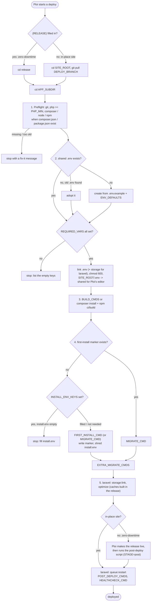

# Deploy script (Ploi, native PHP)

[`src/shell/deploy/ploi-deploy.sh`](../../src/shell/deploy/ploi-deploy.sh) is a deploy
script for any PHP and/or Node app on a native (non-Docker) Ploi server. Edit
its `SETTINGS` block and paste it into the site's deploy script in Ploi.

- **Presets:** `PRESET=laravel` adds the Laravel steps (required `.env` keys,
  shared `storage/`, `key:generate`, `migrate --force`, `optimize`,
  `queue:restart`, `storage:link`). `PRESET=generic` runs only what you configure.
- **Site type:** works on zero-downtime sites (`{RELEASE}`) and on plain in-place
  sites; it detects which one it's on. On a zero-downtime site, paste the same
  script into Ploi's **post-deploy** script too, with `STAGE="post"`
  ([why](#zero-downtime-sites)).
- **Hooks:** every project-specific step is an optional hook, empty by default.

Examples: [generic Laravel](../../examples/generic-laravel/ploi-deploy.settings.sh),
and a multi-tenant app with an admin install command (see [examples/](../../examples/README.md)).

## Contents

- [Pipeline](#pipeline)
- [Settings](#settings)
- [Hooks](#hooks)
- [First run](#first-run)
- [Zero-downtime sites](#zero-downtime-sites)
- [Ploi placeholder caveat](#ploi-placeholder-caveat)

## Pipeline

## Settings

| Setting | Default | Meaning |
|---|---|---|
| `SITE_DOMAIN` | `example.com` | Ploi site domain; also the folder name in `/home/ploi` |
| `PRESET` | `laravel` | `laravel` or `generic` |
| `STAGE` | `main` | `main` in Ploi's deploy script; `post` in the post-deploy script of a zero-downtime site (runs only the live steps) |
| `APP_ENV_NAME` | `production` | `APP_ENV` written into a new shared `.env` (laravel) |
| `DEPLOY_BRANCH` | `main` | branch pulled on in-place sites |
| `APP_SUBDIR` | `.` | app root inside the repository, e.g. `src` |
| `PHP_MIN` / `NODE_MIN_MAJOR` | `8.3.0` / empty | preflight minimums; empty = don't check the version |
| `REQUIRED_VARS` | laravel: `APP_URL DB_HOST DB_PORT DB_DATABASE DB_USERNAME DB_PASSWORD`; generic: none | keys that must be non-empty before the deploy continues |
| `ENV_DEFAULTS` | empty | `KEY=VALUE` pairs written into a **new** shared `.env`; `@SITE_DOMAIN@` is replaced |
| `SITE_ROOT`, `SHARED`, `OLD_ENV` | `/home/ploi/<site>`, `<SITE_ROOT>-shared`, `<SITE_ROOT>/<APP_SUBDIR>/.env` | can be overridden from the environment |

## Hooks

All are shell snippets run with `bash -euo pipefail -c` in the app root; multi-line is fine.

| Hook | Runs | Default |
|---|---|---|
| `BUILD_CMDS` | every deploy | `composer install --no-dev` if `composer.json`, `npm ci && npm run build` if `package.json` |
| `FIRST_INSTALL_CMD` | once, until `<shared>/.first-install-done` exists | `MIGRATE_CMD` |
| `INSTALL_ENV_KEYS` | with the first install | empty. Keys read from `<shared>/install.env` and exported to `FIRST_INSTALL_CMD`; the file is `shred`-deleted afterwards |
| `MIGRATE_CMD` | every later deploy | laravel: `php artisan migrate --force`; generic: none |
| `EXTRA_MIGRATE_CMDS` | after the install or migrate, every deploy | empty (e.g. `php artisan tenants:migrate --force`) |
| `POST_DEPLOY_CMDS` | once the release is live, after `queue:restart` (zero-downtime: in the post-deploy script) | empty |
| `HEALTHCHECK_CMD` | last, against the live release; a failure fails the deploy | empty (e.g. `curl -fsS -o /dev/null https://example.com/up`) |

On a Laravel site that already has `storage/installed` (from an older version of
this script), the first install counts as done.

## First run

The first deploy may stop, on purpose:

1. **Empty `.env` keys.** Fill the `DB_*` values with
   [`update-env-db.sh`](../recipes/configure-a-ploi-web-server.md#update-db_-settings) and the rest in
   Ploi's environment editor, then deploy again.
2. **Install inputs** (only with `INSTALL_ENV_KEYS`). Fill
   `/home/ploi/<site>-shared/install.env` (`KEY=value` lines, `chmod 600`) and
   deploy again.

The queue worker and scheduler run as Ploi daemons ([daemons.md](../recipes/run-daemons.md));
`queue:restart` makes the workers load the new release. Don't also enable a
`schedule:run` cron. `make test` runs the script end to end against a scratch
repository ([`tests/shell/deploy-sandbox.sh`](../../tests/shell/deploy-sandbox.sh)).

## Zero-downtime sites

Ploi runs the main deploy script inside the new release (`{RELEASE}`) and switches the site to it only
after the script ends. Caches (`optimize`) belong there: they are built in the release before visitors
reach it. But a `queue:restart` there is too early: Supervisor restarts the workers in the release that is
still live, so they keep running the old code until the next deploy. The same goes for a health check of
the public URL.

So the main script stops after the caches on a zero-downtime site, and the live steps (`queue:restart`,
`POST_DEPLOY_CMDS`, `HEALTHCHECK_CMD`) run from Ploi's post-deploy script, which runs after the switch:

1. Site → Settings: enable zero-downtime deployment.
2. Deploy script: this script with your settings (`STAGE="main"`).
3. Post-deploy script: the same script and settings with `STAGE="post"`. It only runs the live steps in
   `SITE_ROOT/APP_SUBDIR`. With a settings file, `examples/_shared/ploi-script.sh --post <settings>` prints
   it (without `--post`: the main script).

The restart signal reaches the workers of every release because `storage/` is shared (a file cache store
writes it to the shared `storage/framework/cache`); with Redis or the database cache it is shared anyway.
In-place sites need nothing extra: the code is live as soon as `git pull` returns.

## Ploi placeholder caveat

Ploi replaces its placeholders (`{RELEASE}`, `{BRANCH}`, `{SITE}` and others)
in the deploy script text **before** bash runs it, comments included. A shell
variable written as `${BRANCH}` therefore becomes `$main`, and with `set -u`
the deploy dies with `main: unbound variable`. The script only uses
`{RELEASE}`, on purpose (`cd {RELEASE}`), and names its own variables
`DEPLOY_BRANCH`, `SITE_DOMAIN` and so on. The smoke test
(`make test`) fails if a placeholder name is used as a shell variable.
