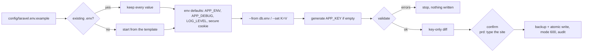

# Laravel `.env` per environment: `workbench env init|check`

`src/shell/env/env.sh` creates and checks a site's `.env` on the web server. It reads and writes values but
**never prints one**: output is key names only (`+ added`, `~ changed`, `* generated`).



## Create

```bash
# on the DB server: the env's DB_* block into a 600 file (no secrets on screen), then fetch it
ssh -t db-1 'sudo /root/docker-db-server-manager.sh env-creds prd --out /root/prd-db.env'
(umask 077; ssh db-1 'sudo cat /root/prd-db.env && sudo rm /root/prd-db.env' > ~/prd-db.env)

# from your workstation: write the prd .env on web-1 (values go over as a file, not argv)
bin/workbench env init --host web-1 --env prd --site app.example.com \
  --from ~/prd-db.env --url https://app.example.com --set MAIL_MAILER=smtp --dry-run
bin/workbench env init --host web-1 --env prd --site app.example.com \
  --from ~/prd-db.env --url https://app.example.com --set MAIL_MAILER=smtp     # type app.example.com
rm ~/prd-db.env
```

| Env | Defaults applied |
|---|---|
| `dev` | `APP_ENV=local` |
| `stg` | `APP_ENV=staging`, `APP_DEBUG=false`, `SESSION_SECURE_COOKIE=true`, `LOG_LEVEL=warning` (if it was `debug`/empty) |
| `prd` | `APP_ENV=production`, `APP_DEBUG=false`, `SESSION_SECURE_COOKIE=true`, `LOG_LEVEL=error` (if it was `debug`/empty) |

- `APP_KEY` is generated (`openssl rand -base64 32`) **only when empty**. An existing key is never replaced,
  not even by `--set APP_KEY=...`: rotating it makes encrypted data and sessions unreadable.
- Values with spaces, `#`, `"`, `$` or `\` are single-quoted (no `${VAR}` expansion); values with a `'`
  are double-quoted and escaped.
- The file is found like Ploi lays it out: `/home/ploi/<site>-shared/.env` for zero-downtime sites, else
  `/home/ploi/<site>/.env`. Use `--path` for anything else.

**Validation** (errors stop the write): `APP_KEY` set and 32 bytes; `APP_ENV` matches; on stg/prd
`APP_DEBUG=false` and `APP_URL` https; DB password set (stg/prd); DB user is not a superuser
(`root`, `postgres`, ...). Warnings: secure cookie off, DB host not private, Postgres 5432 instead of
PgBouncer 6432 on prd, `MAIL_MAILER=log` or `LOG_LEVEL=debug` on prd, duplicate keys.

## Check

```bash
bin/workbench env check --host web-1 --env prd --site app.example.com      # vs the template + rules
bin/workbench env check --path ./stg.env --against ./prd.env                # keys only, both ways (local)
```

Reports keys missing from and extra to the reference, the file mode, and the validation rules above.
Exit 1 on an error, so it fits a deploy hook or cron.

## Templates

- [`config/laravel.env.example`](../../config/laravel.env.example): the Laravel 12/13 skeleton keys plus
  what this stack uses (`DB_SSLMODE`, `AWS_ENDPOINT` for Spaces/Garage, `GOTENBERG_URL`,
  `SESSION_SECURE_COOKIE`, `LOG_STACK=daily`).
- [`config/credentials.env.example`](../../config/credentials.env.example): the workstation credentials file
  for the platform commands (`~/.config/vps-server-workbench/credentials`, mode 600).
