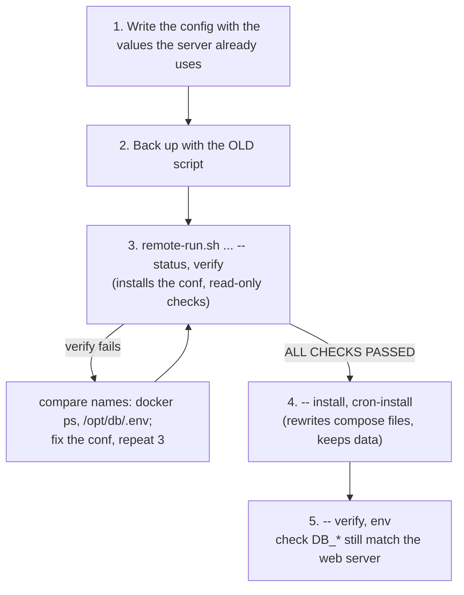

# Moving an existing DB server to this version

> Server already on this repository's manager? Just run `upgrade` (backup, savepoint, auto-rollback): see the
> [rollout plan](runbooks/rollout-plan.md). The steps below are for a server set up with the old single-file script.

For a DB server that was set up with the earlier, single-file version of the
manager (values such as the Postgres user and image name were hardcoded). The
current version has generic defaults (`PG_USER=app`, `PG_DB=app`,
`PG_IMAGE=local/postgres:18-postgis-pgvector`, `VPC_CIDR=10.0.0.0/8`), so
**the config file must go on the server first**. Running the new script
without it would point it at an `app` database that doesn't exist and build a
differently named image.

A worked example for a real server is in [`examples/`](../examples/README.md).

## Rules

- Do **not** use `reset` on a server that has data you want: it deletes all volumes.
- Back up first; copy the backup off the server.
- `install` is non-destructive: it keeps `/opt/db/.env` (passwords) and the
  volumes. It may recreate containers whose definition changed, which means a
  few seconds of downtime. Do it in a quiet period.

## Steps (from your workstation)



1. **Write the config.** Start from
   [`config/db-server.env.example`](../config/db-server.env.example) and set
   every value the running stack uses: `EXPECTED_PRIVATE_IP`, `PRIVATE_IP`,
   `VPC_CIDR`, `PG_USER`, `PG_DB`, `PG_IMAGE`, and any port you changed. Find them on the server:

   ```sh
   ssh <db-alias> 'sudo grep -E "^(PG_|POSTGRES_USER|POSTGRES_DB)" /opt/db/.env | grep -v PASSWORD; \
     sudo docker ps --format "{{.Names}}  {{.Image}}  {{.Ports}}"'
   ```

   Container names should start with `db-` (compose project `db`). If they
   don't, stop: the new script would create a second stack.

2. **Back up** with the script that is already on the server:

   ```sh
   ssh -t <db-alias> 'sudo /root/docker-db-server-manager.sh backup'
   # dumps are root-only (chmod 600): pack them for ploi, copy, delete the copy
   ssh -t <db-alias> 'sudo tar -C /opt/db/backups -czf ~/db-backup.tgz <ts> && sudo chown ploi ~/db-backup.tgz'
   scp <db-alias>:db-backup.tgz ./ && ssh <db-alias> rm db-backup.tgz
   ```

3. **Install the config and the new script, then check only:**

   ```sh
   scripts/db/remote-run.sh --host <db-alias> --expect-ip <private-ip> \
     --config my-db-server.conf -- status, verify
   ```

   This copies the config to `/etc/docker-db-server-manager.conf`, replaces
   `/root/docker-db-server-manager.sh`, and writes `/opt/db/stack.env` on first
   use. `verify` must end with `ALL CHECKS PASSED`.

4. **Apply** (rewrites `docker-compose.yml`, `Dockerfile` and PgBouncer files from
   the current templates; keeps `.env` and data):

   ```sh
   scripts/db/remote-run.sh --host <db-alias> --expect-ip <private-ip> \
     --config my-db-server.conf -- install, cron-install
   ```

5. **Check the web side** still matches: `-- env` and compare with the
   web server's `DB_*` (`update-env-db.sh --dry-run` shows the diff without writing).

`cron-install` rewrites `/etc/cron.d/docker-db-server-backup` so the nightly
job also reads the config file, and adds a logrotate entry for the backup log.
