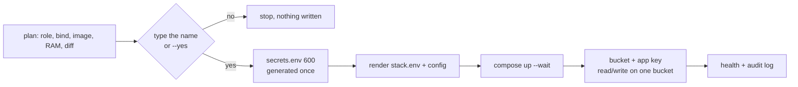

# stacks/addons/

Optional services that sit next to a Laravel app. Each one is a pinned Docker Compose template plus defaults
(`addon.env.example`). [`src/shell/addons/addon.sh`](../../src/shell/addons/addon.sh) renders, starts, checks
and removes them on the node you pick. `bin/siwo configure` and the
[profiles](../../config/profiles) choose which add-ons to use and where.

| Add-on | What | Image (pinned, checked 2026-10) | Default role | RAM (estimate) | Status |
|---|---|---|---|---|---|
| [gotenberg](gotenberg) | HTML, Markdown and Office files to PDF | `gotenberg/gotenberg:8.39.0` | web | ~1 GB limit | stable |
| [garage](garage) | S3-compatible object storage | `dxflrs/garage:v2.5.0` | db | ~256 MB | stable, recommended self-hosted store |
| [seaweedfs](seaweedfs) | S3-compatible object storage + admin UI | `chrislusf/seaweedfs:4.51` | dedicated | ~512 MB+ | stable |
| [rustfs](rustfs) | S3-compatible object storage | `rustfs/rustfs:1.0.4` | dedicated | ~512 MB | **experimental, dev/test only** |

RAM figures are planning estimates, not measurements under your load. A node runs at most **one** object store.

## Quick start

From your workstation (repo root). `DB_HOST` is your SSH alias for the node, and you need a sudo user:

```bash
rsync -a src/shell/addons/addon.sh stacks/addons/ DB_HOST:/tmp/siw-addons-src/
# optional settings (no secrets), e.g. written by `bin/siwo configure`
scp local/<client>/addons-db.conf DB_HOST:/tmp/addons.conf \
  && ssh DB_HOST 'sudo install -m 600 -o root -g root /tmp/addons.conf /etc/vsw-addons.conf && rm /tmp/addons.conf'

ssh DB_HOST 'sudo /tmp/siw-addons-src/addon.sh plan garage'       # writes nothing
ssh -t DB_HOST 'sudo /tmp/siw-addons-src/addon.sh install garage' # type the name to confirm
ssh DB_HOST 'sudo /opt/vsw-addons/addon.sh doctor garage'         # later runs use the installed copy
ssh DB_HOST 'sudo /opt/vsw-addons/addon.sh laravel-env garage --out /root/garage.laravel.env'
```

Then copy the keys from that file into the app `.env` on the web server (they are chmod 600 and never printed)
and run `php artisan config:cache`.

## Where to run what (placement)

| Role | Binds | Use for |
|---|---|---|
| `web` | `127.0.0.1` only | Gotenberg next to PHP. Object storage only on a web node with 4 GB or more. |
| `db` | the VPC (eth1) address | Garage on the DB droplet **after MySQL/MariaDB are turned off** (they need ~1 GB each). |
| `dedicated` | the VPC address | its own droplet: SeaweedFS, or any store holding a lot of data. |

The tool refuses `0.0.0.0`, `::` and public addresses. Docker-published ports bypass ufw, so only binding
to a private address keeps them private. Admin UIs and consoles bind to `127.0.0.1` only. Reach them
with an SSH tunnel, for example `ssh -L 12535:127.0.0.1:12535 root@HOST`.

A 2 GB web node already runs nginx, PHP-FPM, queue workers and the scheduler, so `plan` warns before you
put object storage there.

## What install does



- **Credentials** are generated on the node (`openssl rand`), stored in `/opt/vsw-addons/<name>/secrets.env`
  (chmod 600), never printed and never logged. Re-running `install` keeps them. To rotate them, delete the key
  from `secrets.env` and the matching app key in the store, then run `install` again.
- **App key**: every store gets a key that can read and write the one bucket only. It cannot create or
  delete buckets, and it cannot see other buckets. Garage uses `bucket allow --read --write`, SeaweedFS an
  `s3.json` identity, RustFS an IAM user with the policy `vsw-app-<bucket>` created through its admin API
  (signed with the root key from inside the container). The root key is never written for the app.
- **Project name**: compose projects are `<ADDON_PROJECT_PREFIX>-<name>` (`vsw-garage` by default), recorded
  in `stack.env` as `ADDON_PROJECT` at install so later commands find the containers. Change the prefix only
  for a second, separate set of add-ons on one host (the integration tests do this).
- **Data path**: `ADDON_DATA_DIR`, `/opt/vsw-addons/<name>` by default. A DigitalOcean volume such as
  `/mnt/volume_nyc3_01/garage` keeps object data off the droplet disk and survives a resize. `plan` warns if
  the volume is not mounted.
- **Laravel keys**: `laravel-env` writes `FILESYSTEM_DISK=s3`, `AWS_ACCESS_KEY_ID`, `AWS_SECRET_ACCESS_KEY`,
  `AWS_DEFAULT_REGION`, `AWS_BUCKET`, `AWS_ENDPOINT` and `AWS_USE_PATH_STYLE_ENDPOINT=true` (or
  `GOTENBERG_URL` and the optional basic-auth pair) to a 600 file. Laravel needs
  `composer require league/flysystem-aws-s3-v3 "^3.0"`.
- **Every change** is appended to `/var/log/vsw-addons.log` with no secrets in it.

## Choosing object storage

| | DO Spaces (managed) | Garage | SeaweedFS | RustFS | Ceph (RGW) |
|---|---|---|---|---|---|
| Who runs it | DigitalOcean | you | you | you | you (a team) |
| Smallest useful setup | none | 1 node; 3 for redundancy | 1 node | 1 node | 3+ nodes, cephadm |
| RAM (estimate) | none on your droplets | ~256 MB | ~512 MB+ | ~512 MB | GBs per node |
| Least-privilege key | per-bucket access keys | `bucket allow --read --write` | `s3.json` actions per bucket | IAM user + bucket policy (admin API) | RGW users/policies |
| Redundancy | provider-managed | multi-node, multi-zone layout | replication / erasure coding | erasure coding | full |
| Fit | **default for dev-budget and most production** | small self-hosted, multi-site later | many small files, wants a UI | evaluation only | large clusters only |
| In this repo | docs (below) | add-on, container-tested | add-on, container-tested | add-on, gated | docs only |

See [ADR 0007](../../docs/adr/0007-object-storage-selection.md) for the reasoning.

### DO Spaces (managed alternative)

Nothing to run. Create a bucket in the same region as the droplets. Create an access key **limited to that
bucket** (Spaces keys can be scoped to a bucket with read or read/write). Then set:

```dotenv
FILESYSTEM_DISK=s3
AWS_ACCESS_KEY_ID=...            # the bucket-scoped key
AWS_SECRET_ACCESS_KEY=...
AWS_DEFAULT_REGION=us-east-1     # the SDK needs a value; the endpoint picks the region
AWS_BUCKET=myapp-dev
AWS_ENDPOINT=https://nyc3.digitaloceanspaces.com
AWS_USE_PATH_STYLE_ENDPOINT=false
```

Pricing (estimate, check the DO pricing page): a flat monthly fee covers a storage and transfer allowance.
For a dev or staging app that usually costs less than the extra RAM a self-hosted store needs.

### Ceph (documentation only)

Ceph only makes sense with **three or more** nodes, one or more dedicated disks per node, and someone who
can operate it. It is deployed with `cephadm` (`cephadm bootstrap`, then `ceph orch apply rgw` for S3). It is
far too heavy for a 2 to 4 GB droplet setup. If you outgrow Garage or SeaweedFS, move to a managed store first.

## Backups

Object storage on one droplet is not a backup: the droplet's snapshots and the data share the same fate.

- **Copy the bucket off the node**, for example nightly with rclone to DO Spaces or another provider:
  `rclone sync garage:app spaces:app-backup --s3-no-check-bucket`. Configure the remotes through
  `RCLONE_CONFIG_*` environment variables in a 600 file and never put the keys in the crontab.
- **Garage**: a [three-node cluster](garage/README.md#three-node-cluster) in three zones keeps every object on
  three nodes (it is still not a backup: a delete replicates too). LMDB
  metadata snapshots every 6 hours (`metadata_auto_snapshot_interval`) let you recover from a crash.
- **SeaweedFS**: `weed filer.backup` or `filer.sync` replicate to another cluster or to S3.
- **Credentials**: keep a copy of `secrets.env` in your password manager. Without it, the data is still
  readable on the node, but app keys must be re-issued.

## Doctor checks

`addon.sh doctor [name]` exits 1 on a problem. It checks:

- files are mode 600
- the image is pinned and is what runs
- the container is healthy
- ports are published only on the bind address or 127.0.0.1 (in host mode, via `ss`)
- Gotenberg: basic auth is on when the bind is not loopback, and the SSRF guard is on
- Garage: the layout is applied, and the bucket and app key exist
- SeaweedFS and RustFS: anonymous S3 requests are denied
- data disk usage (warning at 85%, problem at 95%; `ADDON_DISK_WARN_PCT` / `ADDON_DISK_BAD_PCT`)
- free memory

It also warns that object data needs a copy off the node.
